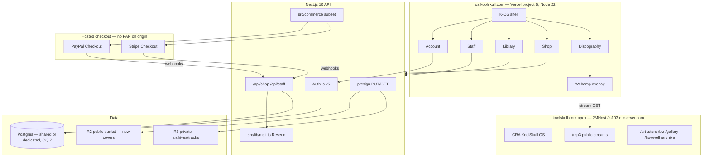

# koolskull.com OS Shop — 2kool.tv-aligned architecture

| Field | Value |
|---|---|
| **Author** | 2kool Productions (systems architecture draft) |
| **Date** | 2026-09-02 |
| **Status** | Draft (Revision 5 — hosting topology: 2MHost vs DreamHost) |
| **Audience** | Senior engineers on K-OS-III / koolskull.com |
| **Primary repo** | `/Users/koolskull/Documents/Github/K-OS-III` (`deploy/2kool-app-merged`, also `2kooltv` / `origin/2kool.tv`) |
| **Live dump** | `/Users/koolskull/Documents/Github/koolskull.com-live/public_html` |
| **Live OS source (recovered)** | `/var/folders/20/45fkqbpj07xffvjwnw54zctr0000gn/T/grok-koolskull/live-os-src/` |

**Revision 2** landed hostname split, capability-URL downloads, mailer, presign PUT, no-guest v1, catalog table, `albumart` AppId, PR 5a–5e, first-party Checkout subset, Node 22, legal gate.

**Revision 3** closed the previous 10 issues (option A Staff, brand-aware helpers, public vs private R2 purposes, PR 1 scope, pending 200, `fulfillOrder` + `user_id` bind, named R2/CORS, denylist, cache-column defaults, script-only owner seed).

**Revision 4** wires option A to real `AccountApp` (no props today): `onLaunchApp` from `page.tsx` only, STAFF hidden on standalone `/account`, shell-held `isStaff`. Return calls `fulfillOrder` only if retrieve is **paid**. v1 is **two R2 buckets** (no public prefix on the private bucket). Vercel B gets `AUTH_TRUST_HOST=true` and a distinct `AUTH_SECRET`. Status spelling is Stripe **`canceled`**. Staff cover upload sets `cover_url` + `cover_large_url` only.

**Revision 5** corrects hosting. **koolskull.com is 2MHost** (`s103.etcserver.com`, A `107.155.127.194`, NS `ns1/ns2.etcnameserver.com`, cPanel + LiteSpeed). **2kool.tv is DreamHost DNS** (`ns1/2/3.dreamhost.com`) with apex already on Vercel (`76.76.21.21`) and `files.2kool.tv` on DreamHost (`67.205.32.77`). Do not copy DreamHost SFTP (`deploy/deploy-2kooltv.sh`) or Apache playbooks onto koolskull.com. Do not run Next.js/Auth.js/Postgres on 2MHost shared cPanel.

---

## Overview

koolskull.com is live today as a compiled Create React App “KoolSkull OS” (`public_html/index.html` → `static/js/main.30781d05.js`) served from **2MHost** cPanel FTP on **`s103.etcserver.com`**. It is a desktop of windows: Discography (`components_MusicLibrary.tsx` + `data_discography.ts`, 21 albums / 264 tracks), Webamp, Art Gallery, a TheatreJS 3D studio, and a client-side `/admin` password gate. There is no real backend. Full album MP3s (~1.8 GB, 289 files) sit world-readable under `public_html/mp3/`. The same apex docroot also serves WooCommerce (`/store/`, Stripe + PayPal + Payerurl), Invoice Ninja (`/biz/`), and WordPress at `/store/`, `/gallery/`, `/howwell/`, `/archive/` (each has `wp-config.php`). Those paths are frozen liabilities, not the shop we will run — and they **must keep resolving on 2MHost**.

This document proposes **not** rewriting that FTP dump in Bun+Vite, and **not** pointing the koolskull.com apex at Vercel. It proposes extending K-OS-III — the Next.js 16 / React 18 / Auth.js / Postgres system that already powers 2kool.tv — as a third build-time brand (`NEXT_PUBLIC_BRAND=koolskull`), deployed as a **second Vercel project** at **`os.koolskull.com`** (`HAS_BACKEND=true`). Apex `koolskull.com` stays on **2MHost** (CRA OS + PHP + `/mp3` + `/art` + `/store` + `/biz` + WordPress) until a written rewrite/proxy map exists. Shop, Discography, Library, and Staff CMS are **OS apps**. Vinyl is $77 + shipping via a staff fulfillment queue (true vinyl pressing is not Printful-style sticker POD). Purchase archives live in private R2 as prebuilt zips; download URLs are **short-TTL capability URLs**, not identity-bound unless a Worker exists (v1: no Worker).

Bun is optional as a **package manager** (`bun install`). **Node 22** runs `next dev` / `next start` / Vercel (matches `.github/workflows/ci.yml`). It is not a reason to abandon Next.js, Auth.js, or the 2kool.tv infrastructure.

### Hosting topology (verified 2026-09-02)

These are **two different companies**. Mixing their deploy playbooks is how you 404 `/store` or upload a Next build to the wrong FTP.

| Site | DNS | A record | What actually serves it | Control panel / stack |
|---|---|---|---|---|
| **koolskull.com** | `ns1.etcnameserver.com` / `ns2.etcnameserver.com` | `107.155.127.194` | **2MHost** shared account on **`s103.etcserver.com`** (same A as the hostname) | **cPanel** + **LiteSpeed** (LSCache) + CloudLinux + PHP. FTP dump is `public_html/`. `.htaccess` has a cPanel PHP handler and COEP/COOP headers. `.litespeed_flag` + LSCache backups are in the dump. |
| **2kool.tv** | `ns1/2/3.dreamhost.com` | `76.76.21.21` (**Vercel** anycast) | Node/static OS on **Vercel** | DreamHost only for DNS + **`files.2kool.tv`** (`67.205.32.77`, real DreamHost). `deploy/deploy-2kooltv.sh` is **this** SFTP path, not koolskull.com. |

2MHost plans (cPanel hosting / LiteSpeed “Performance”) advertise **MySQL 8**, PHP 8.x, FTP, SSH, Git, Jetemail (300 outbound/hour), Redis on performance plans. They do **not** advertise PostgreSQL or a supported Next.js 16 + Auth.js runtime. **Do not** put `next start` on s103. Subdomains are free in cPanel; v1 still **CNAME `os.koolskull.com` to Vercel** in the 2MHost zone editor rather than creating a `public_html/os.koolskull.com` folder (that folder would only matter if the name stayed on s103).

TLS: 2MHost AutoSSL covers names that **resolve to s103**. A Vercel-hosted `os.` gets a **Vercel** cert. Wildcard SSL on 2MHost does not cover a CNAME that leaves the server.

Mail: `@koolskull.com` mailboxes live on 2MHost/Jetemail. Shop **transactional** mail still goes through Resend (verified `MAIL_FROM` on this domain). Do not blast receipts through the 300/hour mailbox cap.

---

## Background & Motivation

### Current live OS (CRA, compiled)

Entry is a stock CRA shell:

```html
<title>KoolSkull OS</title>
<script defer="defer" src="/static/js/main.30781d05.js"></script>
```

Recovered TypeScript in `live-os-src/KoolSkullOS.tsx` defines the desktop:

```ts
const desktopIcons = [
  { name: 'Home', path: '/', icon: homeIcon },
  { name: 'Contact', path: '/contact', icon: contactIcon },
  { name: 'Music', path: '/music', icon: musicIcon },
  { name: 'Discography', path: '/discography', icon: discographyIcon },
  { name: '3D Studio', path: '/3dstudio', icon: studio3dIcon },
  { name: 'Art Gallery', path: '/artgallery', icon: portfolioIcon }
];
```

Behavior that must be preserved or deliberately changed:

| Live behavior | File | Decision |
|---|---|---|
| **Music** icon toggles Webamp (`showWebamp`); it is **not** a window | `KoolSkullOS.tsx` `toggleWindow('Music')` ~L414–423, render ~L831–838 | **Remove the Music desktop icon.** Webamp launches from Discography (and Shop). |
| **Discography** opens `MusicLibrary` (default view `'square'`, cycles square → grid → list) | `components_MusicLibrary.tsx` | **Keep.** Port UX; catalog from Postgres, not the 93 KB TS file. |
| Album click/double-click loads Webamp playlist + `AlbumArtViewer` window | `handleSelectAlbum` ~L276–338 **closes and reopens** the art window | **Keep**, including close/reopen. `albumart` is a real `AppId` with `desktop: false`. |
| Art Gallery / Artwork Viewer / CombinedArtViewer | `components_ArtPortfolio.tsx`, `data_artPortfolioData.ts`, `public_html/art/` (723 fullsize + 723 thumbs, ~287 MB) | **Discontinue for koolskull brand** (manager: “discontinue the portfolio app”). Confirm in Open Questions. |
| `/admin` client-side password, `sessionStorage.adminAuthenticated` | `components_Admin.tsx` | **Security incident.** Do not port. Do not copy the secret into this repo or this doc. Rotate anything that reused it. |
| AdminPanel is an art-metadata CMS talking to `/art/source-manifest.json` and a stub `POST /api/admin/move-file` | `components_AdminPanel.tsx` | Dies with the portfolio app. Staff CMS is a new shop admin, not this panel. |
| Home / About / Projects / Contact | `components_{Home,About,Projects,Contact}.tsx` | Home has a real artist statement; Contact has real rates (`juan@koolskull.com`, phone). About is filler (“Founded in 2025”). Projects is placeholder junk. **Do not keep dead windows.** Fold Home+Contact into a brand-gated English Manual article. |
| 3D Studio (TheatreJS + THREE) | `components_TheatreJS.tsx` | **Do not port in v1.** Not a catalog flag. K-OS-III has `three` / `@react-three/fiber` for Datamoshpit/SkullMash, not TheatreJS, and no `3dstudio` id. |
| LAClock / CryptoTicker | in `componentsMap`, **not** in `desktopIcons` | Do not port. |
| Webamp skins | `public_html/webampskins/{BlackSimple,Chemical_Reaction}.wsz` plus CDN skins in `components_WebampPlayer.tsx` | Keep on the media host (`https://koolskull.com/webampskins/…`). |
| Player art | `public_html/player/` | Keep as static media on 2MHost. |
| Older HTML discography (98.css, Bandcamp / Apple Music links) | `public_html/discography/albums.html` | Legacy. Do not rebuild in 98.css. Optional external-link fields on `releases`. |

Discography data (`data_discography.ts`, 94,307 bytes) is auto-generated. Shape:

```ts
export interface MusicAlbum {
  id: string;          // slug, e.g. "audiotrash-korgpainter"
  title: string;
  artist: string;      // "KOOL SKULL"
  year: string;
  coverUrl?: string;   // /mp3/KOOL SKULL - {ALBUM}/cover.jpg
  thumbUrl?: string;   // /album-thumbs/{id}.jpg
  largeUrl?: string;   // /album-large/{id}.jpg
  fullscreenUrl?: string;
  tracks: MusicTrack[];
}
export interface MusicTrack {
  url: string;         // public /mp3/.../*.mp3
  duration: number;    // seconds, float
  metaData: { artist: string; title: string; album?: string };
}
```

**21 albums, 264 tracks.** IDs: `audiotrash-korgpainter`, `b8kdbrkz`, `bestowing-grace-through-creation`, `big-booty-thrash`, `big-daddy-kool-skull`, `cybertemplar-audioweaponz-12212020`, `halloween-special`, `heavenly-thrash`, `hollywood-cowboy`, `island-of-ooze`, `jankler-jamz-vol--1`, `just-another-thrash-reckord`, `merry-g-----l--i---t----c--h---mas`, `ow2bkool-ii`, `pinwheel`, `puke-on-the-sidewalk`, `stardrain---chapter-1--2k4d`, `thrash-prophet`, `tiger-tooth-cavities`, `various-instrumentals`, `yum`.

Vendor this metadata (no audio) as `scripts/data/discography.json` in K-OS-III. Do not import from the recovered `/var/folders/…/live-os-src/` tree at CI time.

Some titles/tracks are NSFW or political. The shop still sells them. No extra moralizing, no hidden catalog. Processors may still object — see legal go-live gate.

### Current 2kool.tv / K-OS-III (the infrastructure we must match)

Verified on branch `deploy/2kool-app-merged` (`b51ab905`), `package.json` name `koolskull-os-iii@0.2.2-beta`:

| Layer | Reality |
|---|---|
| Framework | Next.js `^16.1.6`, React 18, TypeScript, Tailwind 4 (`src/app/globals.css` `@import "tailwindcss"`) |
| Auth | next-auth v5 (`src/auth.ts`) + `@auth/pg-adapter` + `pg`. JWT sessions. Providers: Google, X (env-gated), email+password (`src/lib/password-auth.ts`, `POST /api/auth/register`), Matrix verify-then-logout (`src/lib/matrix-auth.ts`), Ethereum SIWE EIP-4361 (`src/lib/ethereum-auth.ts`, `siwe` + `ethers`) |
| Wallets | EIP-6963 discovery + WalletConnect (`src/lib/walletProviders.ts`) |
| API gate | `requireUserId()` in `src/lib/api-auth.ts` — **no staff-role helper yet** |
| DB | `db/schema.sql` — Auth.js `users/accounts/sessions/verification_token` + `profiles` + `profile_blocks` + chat ephemeral + PRODEV + Shotlist + KoolDraw + Datamoshpit renders + `user_assets`. Local Postgres 16 on **5433** (`docker-compose.dev.yml`). Prod: comment says owner self-host; `docs/DEPLOYMENT.md` Target 3 also documents **Neon + Vercel** for 2kool.tv |
| OS shell | `src/app/page.tsx` boot → `Desktop` → `Taskbar` → `AppWindow`. `launchApp` requires a catalog `AppId` (`canLaunchApp` + `APP_DEFAULTS` from `APP_CATALOG`; missing id → App Manager or silent return). Launch extras already exist (`chatLaunch`, `shotlistLaunch`, `kooldrawLaunch`) |
| App catalog | `src/lib/apps/catalog.ts` — `core` vs `bundled`, `preinstall`, `requiresCloud`. `desktopPackages()` **always shows every `tier: "core"` app** (`installStore.ts` L182–188). `education` is core **and** preinstall (L91–103). App Manager lists `availableCatalog()` (`AppManagerApp.tsx` L68). Install state key `kos-app-installs-v1` |
| Brand flags | `src/lib/buildFlags.ts` — `BRAND: "kos3" \| "2kooltv"`; unknown env collapses to `"kos3"`. `HAS_BACKEND = NEXT_PUBLIC_STATIC_EXPORT !== "true"` |
| Commerce | **Design only.** `docs/COMMERCE_SPEC.md`. Seed issues 24–26 in `docs/SEED_ISSUES.md` (`src/commerce/`, Stripe adapter **dev-mode only**, `<FeeDisplay>`). **No `src/commerce/` directory exists.** |
| Mail | **None.** `nodemailer` is only an optional peer of `next-auth` in `package-lock.json`. `verification_token` exists in DDL and is unused by app code |
| Deploy | Static export via `scripts/build-static.sh` (moves `src/app/api` and `src/app/render` out of tree). `npm run build:2kooltv`. SFTP mirror `deploy/deploy-2kooltv.sh` (**never deletes** extra files — an SFTP rule, not a Vercel path map). Node deploy documented as Vercel for `/api/*`. CI: Node **22**, `npm ci --legacy-peer-deps`. No `bun.lock`, no `packageManager`, no `engines` |
| Uploads | `src/lib/uploads.ts` writes `public/uploads/`, 30 MB audio cap, “fine for the live Node deploy … not serverless/edge” |
| Rate limit pattern | Datamoshpit `COUNT(*) … created_at > now() - interval '1 hour'` in `src/app/api/datamoshpit/renders/route.ts` (no Redis) |
| Asset URLs | `src/lib/assets.ts` `assetUrl()` — `NEXT_PUBLIC_BASE_PATH` / `NEXT_PUBLIC_ASSET_BASE`. **No `process.env.PUBLIC_URL`** (that is CRA) |
| Headers | `next.config.ts`: `COOP: same-origin`, `COEP: credentialless` |
| Manual i18n | `src/lib/doc/articles.ts` `LANGUAGES = en/es/ja/zh` |
| UI law | `koolskull-os-ui-notes.md`: no rounded corners, no anti-aliasing, no gradient preset buttons, pixel fonts, black chrome. `AppWindow` already sets `imageRendering: "pixelated"` |

Accounts are **additive, never a gate for creative tools** (`docs/ACCOUNTS_SPEC.md` §1, `docs/ECONOMIC_STANCE.md`). K-OS **never takes custody of funds** (`COMMERCE_SPEC.md` §7). PRODEV roles are `owner | contributor` on **projects** (`prodev_members`) — **do not overload them for shop staff.**

### Pain points this change exists to kill

1. Owner and employees cannot edit catalog, prices, or orders without an engineer + FTP.
2. `/admin` is a client-side password compiled into public JS. Anyone can read it.
3. A paid-download shop cannot honestly exist if the purchase zip is the same world-readable `/mp3` tree — **unless** we sell convenience archives while disclosing Bandcamp-like public streams (v1 policy).
4. Music is split across a Music **button** and a Discography **icon**; manager wants one desktop path.
5. Art Gallery is a 723-image portfolio the manager ordered discontinued.
6. WooCommerce + Invoice Ninja + four WordPress trees are unmaintainable parallel commerce — but their **URLs must not 404** if apex DNS moves.
7. koolskull.com cannot run Auth.js or Postgres on 2MHost shared cPanel (MySQL + LiteSpeed + PHP FTP docroot). 2kool.tv already solved Node by putting **apex on Vercel** and leaving **`files.2kool.tv` on DreamHost**. koolskull must **not** copy that apex flip: koolskull’s apex is a multi-app PHP/CRA tree on **s103**, not “an OS plus `/media`.”

---

## Goals & Non-Goals

### Goals

- One OS **at `os.koolskull.com`**: looks and behaves like 2kool.tv (shell, chrome, fonts, App Manager, boot).
- Apex `koolskull.com` keeps serving the existing 2MHost tree until a written rewrite map exists.
- Functional shop: digital album **archives** (prebuilt zip in R2) + optional vinyl at **$77 + shipping**, staff-managed.
- Owner + employees edit catalog, prices, vinyl enablement, orders, fulfillment, with distinct roles.
- Customer accounts: email/password and/or Ethereum SIWE (reuse `src/auth.ts`). Optional Google/X.
- Preserve Discography visual language (square album grid, grid, list) and Webamp skins.
- Entitlements + **POST-minted** short-TTL **capability URLs** for archives.
- First-party **hosted Checkout** adapters implementing a **subset** of COMMERCE_SPEC (Stripe, then PayPal). Not a Shopify embed. Not the spec’s P2P router.
- Incremental PRs, each mergeable. Live FTP CRA remains the public OS at apex until the owner chooses otherwise.
- `HAS_BACKEND=true` on the **`os.koolskull.com` Node deploy**. Static `build:koolskull` is a degraded OS (Discography browse only, no account/shop).

### Non-Goals (v1)

- Greenfield Bun + Hono + Vite rewrite of the FTP dump.
- Pointing **apex** `koolskull.com` at Vercel / Node.
- Shopify (or any hosted storefront iframe) as the shop.
- Migrating WooCommerce / Invoice Ninja historical orders (freeze those trees; **keep their URLs on 2MHost**).
- Putting MP3s or `/art/` in git.
- K-OS marketplace / peer-to-peer commerce / K-OS-charged platform fee.
- Crypto **payments** (Payerurl, on-chain checkout). Wallets are **identity** (SIWE). EVM adapters stay later COMMERCE_SPEC work.
- Printful/Gelato “vinyl POD” (they do not press records).
- Porting Art Gallery, AdminPanel, About, Projects, LAClock, CryptoTicker, **TheatreJS / 3D Studio**.
- Guest vinyl or guest digital checkout.
- Overloading `prodev_members.role` for shop staff.
- Gating Datamoshpit / KoolDraw / other creative tools behind login (ECONOMIC_STANCE). Shop checkout requires identity; drawing tools may not.
- R2 Worker / identity-bound downloads; `max_uses` enforcement without a Worker.
- Bun as the **process** executing Next 16 + Auth.js v5 + `pg` (optional `bun install` only, until a spike PR).
- Hyper-scale design. Tens of albums, hundreds of tracks, low QPS.
- Replacing 2kool.tv or kos3 brand catalogs.
- Four-language Manual articles for koolskull Home/Contact (English-only brand-gate).

---

## Key Decisions

1. **Third brand on K-OS-III, not a new repo.** `NEXT_PUBLIC_BRAND=koolskull` alongside `"kos3" | "2kooltv"` in `src/lib/buildFlags.ts`. Shares shell, Auth.js, Postgres, App Manager, chrome. (Open Question 5 if the owner wants isolation.)

2. **Bun = optional package manager. Node 22 is the runtime.** `bun install` is allowed; do not add `bun.lock` in the brand-flag PR. `next dev` / `next start` / Vercel / CI stay Node 22 + npm (`ci.yml` already). If the owner insists on Bun as the process, a spike PR must run register + SIWE + a fake webhook on `bun --bun next start` before the shop depends on it.

3. **Shop is OS apps, not a website-in-a-window.** Discography, Shop, Library, Staff, Account. Webamp is **not** a desktop icon and **not** an `AppWindow` (Winamp chrome, same as live overlay). `albumart` **is** a catalog `AppId` with `desktop: false`.

4. **No Music desktop icon.** Manager order. Taskbar may still show a Webamp button while the overlay is open (live L973–979).

5. **Art Gallery / ArtPortfolio is the “portfolio app” to discontinue.** Do not port. Files stay on **2MHost** disk. Confirm with owner (Open Question 1).

6. **Replace `/admin` immediately.** Hardcoded client-side password is an incident. Staff auth = Auth.js session + `staff_roles`. Never ship client-side secrets. Ops 410 on **2MHost** `.htaccess` **before** PR 1.

7. **Do not overload PRODEV roles.** New `staff_roles(user_id, role)`. Roles: `owner`, `shop_manager`, `fulfillment`, `support`. `requireStaff(allowed[])` is an **allow-list**; `owner` always passes. Bootstrap is **script-only** (`scripts/bootstrap-staff-owner.ts`); SIWE-only owner uses `STAFF_OWNER_USER_ID` (email env is a no-op if `users.email` is null). Roles from DB per request, not JWT. `staff` AppId is `desktop: false` — launch from Account **inside the OS** via `AccountApp onLaunchApp`, not from standalone `/account`.

8. **v1 commerce is first-party hosted Checkout, a subset of COMMERCE_SPEC — not the P2P router.** Apps call `Commerce.requestPayment` / `refund` / `getReceipt`. The Shop client sends `method: "card" | "paypal"`; the server maps `card → stripe`, `paypal → paypal`. Settlement is Koolskull’s merchant account. This **overrides** seed issue 25’s “dev-mode only, no live keys” when production keys are used — production Stripe is a **named-reviewer PR (5b)** still, but it is allowed to take live keys. EVM/Plaid/Connect/`acceptPayment` stay unimplemented.

9. **Vinyl is a staff fulfillment queue, not a sticker-POD API.** Price locked at **$77 + shipping**. `qty` must be `1`. v1 shipping mechanism: **Stripe Checkout `shipping_options`** (and PayPal equivalent when that rail ships). Manufacturer API later. Open Question 9 still picks regions/rates.

10. **Bandcamp-like public streams + paid private archives.** Webamp keeps playing the existing lossy `/mp3` files on **2MHost** (`NEXT_PUBLIC_MEDIA_ORIGIN=https://koolskull.com`). Purchase downloads a **prebuilt zip** (`releases.archive_key` in private R2). Do **not** silently switch the player to 30s previews (Open Question 6). Capability URLs (presigned GET, ~15 min TTL, unguessable). No `max_uses` in v1 (would lie without a Worker). Mint via **POST**. `SHOP_PAYMENTS_ENABLED=true` in prod requires every active digital product to have `archive_key` set.

11. **Digital and vinyl checkout both require a signed-in account in v1.** No guest vinyl (avoids receipt/IDOR/mail loops). Collect `orders.email` at checkout for receipts. **Never write checkout email onto `users.email`** (`UNIQUE`; SIWE users are `INSERT INTO users (name)` only — `account-upsert.ts` L53–57).

12. **Hostname split: apex stays 2MHost (`s103.etcserver.com`); Node shop is `os.koolskull.com` on a second Vercel project.** Do not copy `deploy/deploy-2kooltv.sh` (DreamHost SFTP) onto koolskull.com. Do not copy 2kool.tv’s apex A→`76.76.21.21` onto koolskull.com (that would take down PHP/Woo/`/mp3` on s103). Add `os.koolskull.com` as a **CNAME to Vercel** in the **2MHost** DNS zone (`etcnameserver.com`). `AUTH_URL=https://os.koolskull.com`. Static `build:koolskull` is degraded FTP fallback **to 2MHost** only. Open Question 17 if the owner wants apex moved later — then a path-by-path rewrite map is mandatory.

13. **WooCommerce / `store/`, Invoice Ninja / `biz/`, WordPress trees are frozen on 2MHost (MySQL).** New shop is greenfield on Postgres (Vercel B / Neon or owner Postgres — **not** 2MHost MySQL). Freeze ≠ delete; those URLs stay up on s103.

14. **First-party seller, not a marketplace.** No `users.balance`. K-OS fee `$0` in v1 (COMMERCE_SPEC §9 Q1 still open).

15. **Brand-scoped catalog, not “omit brands = hope.”** End-state table below. `canLaunchApp`, `isCoreApp`, `desktopPackages`, and `availableCatalog` are **one formula** (see catalog section). Namespace `localStorage` as `kos-app-installs-v1-${BRAND}`. Filter `requiresStaff` in App Manager. `staff` never has a desktop icon.

16. **Mailer before checkout.** Resend (v1 fallback; Open Question 18 for From domain / Postmark/SES). `src/lib/mail.ts` (**new**). Templates: order paid, archive link, vinyl shipped, staff resend. No “we will email them” as an unimplemented webhook side effect.

17. **Staff uploads are R2/S3 presigned PUT only.** `purpose: "archive"|"track"` → **private `R2_BUCKET`**; `purpose: "cover"` → **public `R2_PUBLIC_BUCKET`**. Two buckets, not a prefix. Next never `formData()`’s masters or zips. Catalog `` uses absolute public URLs — **no signed GET for covers**. One JPEG updates `cover_url` + `cover_large_url` only.

18. **`products` is the source of truth for price and saleability.** `releases.digital_enabled` / `vinyl_enabled` are **strict copies of `products.active`** (default **false**), written in the same transaction as `products.price_cents` → `releases.*_price_cents`. SKU pattern `ks-{slug}-digital` / `ks-{slug}-vinyl`. Duplicate digital purchase → **409 before redirect**. Refund/chargeback **deletes** the entitlement.

19. **Hosted-checkout return path:** `GET /api/shop/checkout/return?session_id=…` retrieves the processor session, **requires `orders.user_id` = session user**, and calls **`fulfillOrder` only if `retrieve().paid`**. Unpaid/open/expired sessions redirect to Shop pending/`canceled` — never grant entitlements. Webhook `checkout.session.completed` also calls `fulfillOrder` (idempotent). Not `?paid=1`. Library poll is UX. Pending + same `idempotency_key` → **200 original `redirectUrl`**. Reap `pending` older than 24h → `canceled`.

20. **Legal checklist is a prod go-live gate** for `SHOP_PAYMENTS_ENABLED`, not only “webhooks green.” Open Questions 12, 21–24 stay open; the gate is “answered or explicit defer,” not silent.

---

## Proposed Design

### Architecture



### Hostname split (v1)

| Host | What it serves | DNS |
|---|---|---|
| `koolskull.com` / `www` | Existing **2MHost** `public_html` on `s103.etcserver.com`: CRA `/`, `/mp3`, `/art`, `/album-*`, `/webampskins`, `/player`, `/store`, `/biz`, `/gallery`, `/howwell`, `/archive` | **Unchanged** A `107.155.127.194` (2MHost). Zone on `etcnameserver.com`. |
| `os.koolskull.com` | K-OS-III Node app, brand `koolskull`, `HAS_BACKEND=true` | **CNAME in the 2MHost zone** → Vercel (`cname.vercel-dns.com`). Do **not** also create a cPanel subdomain document root unless the CNAME is removed. |
| Optional later `files.koolskull.com` | If public media is ever split from apex | Still 2MHost, or R2 public |

`deploy/deploy-2kooltv.sh` is **DreamHost SFTP for 2kool.tv**. It does not upload to s103 and does not make Vercel serve 2MHost files. Freeze of Woo/Invoice Ninja is not “those URLs keep working on Node.”

If apex ever moves (Open Question 17), a written rewrite/proxy map is required **before** DNS, covering at least:

`/store`, `/biz`, `/gallery`, `/howwell`, `/archive`, `/mp3`, `/art`, `/album-thumbs`, `/album-large`, `/album-fullscreen`, `/webampskins`, `/player`, `/static/js/main.*`, `/admin` (410), plus TLS ownership on both hosts.

**v1 engineering fallback:** subdomain Node, apex CRA. Discography on `os.` plays streams from `https://koolskull.com/mp3/…` via `NEXT_PUBLIC_MEDIA_ORIGIN`. COEP `credentialless` on the Node app allows cross-origin media without CORP.

#### CORS appendix (required or Webamp/covers/PUT break)

| Origin | Paths / methods | `Access-Control-Allow-Origin` | Notes |
|---|---|---|---|
| 2MHost apex (LiteSpeed) | `GET /mp3/*`, `GET /webampskins/*`, `GET /album-*/*` | `https://os.koolskull.com` and `http://localhost:5555` | Webamp fetches **skins (`.wsz`)** as well as MP3s — ACAO on `/webampskins` is not optional. `HEAD` same. Live `.htaccess` already sets COEP `require-corp` + COOP `same-origin` — **relax COEP on media paths** or Webamp/cross-origin from `os.` will fail (Node app uses `credentialless`). |
| R2 **private** bucket | `PUT`, `HEAD` (presign upload) | `https://os.koolskull.com`, `http://localhost:5555`; allow `Content-Type` | Browser PUT. Confirm uses **server-side HEAD with credentials** (no CORS). |
| R2 **public bucket** (`R2_PUBLIC_BUCKET`, origin `R2_PUBLIC_BASE_URL`) | `GET` (covers); `PUT`/`HEAD` for Staff cover upload | GET: `*` or the two origins; PUT: same as private | Catalog `` from `os.`. Cache-Control `public, max-age=86400`. **No signed GET.** Confirm HEAD is server-side. |

LiteSpeed/.htaccess sketch (apex `public_html/.htaccess` on 2MHost): `Header set Access-Control-Allow-Origin "https://os.koolskull.com"` on `/mp3`, `/webampskins`, `/album-thumbs`, `/album-large`, `/album-fullscreen`. LiteSpeed honors Apache-style `mod_headers` (the live file already uses `<IfModule mod_headers.c>`). Localhost: extra origin if the host allows two ACAO values; otherwise skip localhost CORS and proxy media in `next dev`.

### Deploy matrix

| Project | `NEXT_PUBLIC_BRAND` | `AUTH_URL` | `HAS_BACKEND` | `DATABASE_URL` | Media | Runtime |
|---|---|---|---|---|---|---|
| Vercel **A** (existing) | `2kooltv` | `https://2kool.tv` | true | Neon or owner self-host (OQ 8) | `files.2kool.tv` **DreamHost** | Node 22 |
| Vercel **B** (**new**) | `koolskull` | `https://os.koolskull.com` | true | **v1 fallback: same Postgres as A** (OQ 7) — **not** 2MHost MySQL | Public streams: `https://koolskull.com` (**2MHost**); new covers: **R2 public bucket**; archives: **R2 private bucket** | Node 22 |
| GitHub Pages | `kos3` | n/a | false (`build-static.sh`) | none | in `out/` | static |
| **2MHost** apex (`s103`) | n/a (CRA) | n/a | n/a | WP/Woo/Ninja **MySQL** (untouched) | local disk | LiteSpeed + PHP/cPanel |
| **DreamHost** `files.2kool.tv` | n/a | n/a | n/a | n/a | 2kool.tv static assets | Apache |
| Local | unset/`koolskull` | `http://localhost:5555` | true | `docker-compose.dev.yml` `:5433` | `NEXT_PUBLIC_MEDIA_ORIGIN` | Node 22 |

One Vercel project cannot bake two `NEXT_PUBLIC_BRAND` values. koolskull **must** be a second project.

**Vercel B Auth.js env** (in addition to `DATABASE_URL`, Stripe/PayPal/R2/mail):

| Var | Vercel B value |
|---|---|
| `AUTH_URL` | `https://os.koolskull.com` |
| `AUTH_TRUST_HOST` | `true` (same as Target 3 for 2kool.tv; without it Auth.js throws `UntrustedHost` on Vercel) |
| `AUTH_SECRET` | **distinct from Vercel A** — do not reuse 2kool.tv’s secret |

Shared Postgres (v1 fallback) implies: two origins, two OAuth redirect URIs (`/api/auth/callback/google` and `/twitter` on **each** host), two WalletConnect allowlist entries, one `users` table, two `AUTH_SECRET`s (do **not** share session cookies across domains — Auth.js cookies are host-only). SIWE messages bind `window.location.host`.

Static `package.json` scripts:

```json
"build:koolskull": "NEXT_PUBLIC_BASE_PATH= NEXT_PUBLIC_BRAND=koolskull ./scripts/build-static.sh",
"build:koolskull:node": "NEXT_PUBLIC_BASE_PATH= NEXT_PUBLIC_BRAND=koolskull next build"
```

`build:koolskull` (static) is degraded FTP fallback only. Live shop is `build:koolskull:node` on Vercel B.

### Brand flag

Today (`src/lib/buildFlags.ts`):

```ts
export const BRAND: "kos3" | "2kooltv" =
  process.env.NEXT_PUBLIC_BRAND === "2kooltv" ? "2kooltv" : "kos3";
```

Proposed:

```ts
export type Brand = "kos3" | "2kooltv" | "koolskull";

export const BRAND: Brand =
  process.env.NEXT_PUBLIC_BRAND === "2kooltv" ? "2kooltv"
  : process.env.NEXT_PUBLIC_BRAND === "koolskull" ? "koolskull"
  : "kos3";

export const HAS_BACKEND = process.env.NEXT_PUBLIC_STATIC_EXPORT !== "true";

export const BRAND_NAME =
  BRAND === "2kooltv" ? "2KOOL.TV"
  : BRAND === "koolskull" ? "KOOLSKULL"
  : "K-OS III";
```

Call sites today: `src/lib/buildFlags.ts`, `src/app/layout.tsx`, `src/components/os/BootSequence.tsx`, `src/components/os/Taskbar.tsx`, `src/lib/apps/catalog.ts`.

### koolskull app catalog

Extend `AppPackage` in `src/lib/apps/catalog.ts`:

```ts
brands?: Brand[];            // omit = all brands; filters availableCatalog
preinstallFor?: Brand[];     // if set, seed only these brands; else all brands that can see the app
desktop?: boolean;           // default true; false → launchable, not an icon
requiresStaff?: boolean;
```

These four helpers **must stay identical** to the table. `page.tsx` `launchApp` calls `canLaunchApp(id, { isStaff })` (session from `/api/staff/me` or `/api/auth/session` + roles). Ids not in `availableCatalog` **never** launch (no App Manager bounce for brand-filtered apps; ignore or no-op).

```ts
export function availableCatalog(opts?: { isStaff?: boolean }): AppPackage[] {
  return APP_CATALOG.filter((a) => {
    if (!HAS_BACKEND && a.requiresCloud) return false;
    if (a.brands && !a.brands.includes(BRAND)) return false;
    if (a.requiresStaff && !opts?.isStaff) return false;
    return true;
  });
}

/** Uninstall lock: core AND available in this brand. Education is core on 2kooltv, not on koolskull. */
export function isCoreApp(id: string): boolean {
  const pkg = getAppPackage(id);
  if (!pkg || pkg.tier !== "core") return false;
  return availableCatalog().some((a) => a.id === pkg.id);
}

export function preinstallAppIds(): AppId[] {
  // Seed without a session: omit requiresStaff rows (staff is not preinstalled).
  return availableCatalog({ isStaff: false }).filter((a) => {
    if (a.tier === "core") return true;
    if (!a.preinstall) return false;
    if (a.preinstallFor) return a.preinstallFor.includes(BRAND);
    return true;
  }).map((a) => a.id);
}

export function desktopPackages(state: InstallStoreState, opts?: { isStaff?: boolean }): AppPackage[] {
  return availableCatalog(opts).filter((pkg) => {
    if (pkg.desktop === false) return false; // albumart, staff
    if (pkg.tier === "core") return true;
    return Boolean(state.installs[pkg.id]);
  });
}

/**
 * Launch gate (replaces installStore.ts L190–193).
 * true iff in availableCatalog({ isStaff }) AND
 *   (core-for-this-brand ∪ installed ∪ desktop===false ∪ (requiresStaff && isStaff)).
 * Staff: desktop false, requiresStaff; no localStorage row; Account launchApp("staff") works
 * when isStaff. Education on koolskull: not in availableCatalog → false.
 */
export function canLaunchApp(id: string, opts?: { isStaff?: boolean }): boolean {
  const pkg = availableCatalog(opts).find((a) => a.id === id);
  if (!pkg) return false;
  if (pkg.tier === "core") return true;
  if (pkg.desktop === false) return true;
  if (pkg.requiresStaff && opts?.isStaff) return true;
  return isInstalled(id);
}
```

Install storage: `kos-app-installs-v1-${BRAND}` (same suffix for `kos-user-badges-v1` / `kos-app-usage-v1`).

App Manager lists `availableCatalog({ isStaff })` and **omits `desktop === false`** (albumart/staff are not installable toys). Visitors never see Staff.

#### End-state `APP_CATALOG` (not PR 1 scope)

This table is the **end state** after PRs 3–5d. **PR 1 only** adds `Brand` + the new fields on **existing** rows (`education.brands`, bible/kooldraw `preinstallFor`, helper rewrites, storage key). New `AppId`s land in the PR that ships the window (`discography`/`albumart` in PR 3, `staff` in PR 4, `shop`/`library` in PR 5d).

Legend: `—` = omit field (all brands / default). `ks` = koolskull, `2k` = 2kooltv, `k3` = kos3.

| id | brands | tier | preinstall / preinstallFor | desktop | requiresCloud | requiresStaff | koolskull desktop |
|---|---|---|---|---|---|---|---|
| `appmanager` | — | core | core | true | | | yes |
| `manual` | — | core | core | true | | | yes |
| `account` | — | core | core | true | yes | | yes (hidden if `!HAS_BACKEND`, already) |
| `education` | `k3, 2k` | **core** (unchanged on 2kooltv) | core | true | | | **no** (not in koolskull catalog) |
| `bible` | — | bundled | `preinstallFor: [k3,2k]` | true | | | installable, not preinstalled |
| `datamoshpit` | — | bundled | | true | | | installable |
| `kooldraw` | — | bundled | `preinstallFor: [k3,2k]` | true | | | installable, not preinstalled |
| `shotlist` | — | bundled | | true | | | installable |
| `tilemap` | — | bundled | | true | | | installable |
| `skulltext` | — | bundled | | true | | | installable |
| `skullmash` | — | bundled | | true | | | installable |
| `notes` | — | bundled | | true | | | installable |
| `nodemap` | — | bundled | | true | | | installable |
| `stance` | — | bundled | | true | | | installable |
| `games` | — | bundled | | true | | | installable |
| `stardrain-wiki` | — | bundled | | true | | | installable |
| `browser` | — | bundled | | true | yes | | installable if backend |
| `prodev` | — | bundled | | true | yes | | installable if backend |
| `chat` | — | bundled | | true | yes | | installable if backend |
| `discography` | `[ks]` | bundled | preinstall on ks | true | | | **yes** |
| `shop` | `[ks]` | bundled | preinstall on ks | true | yes | | **yes** |
| `library` | `[ks]` | bundled | preinstall on ks | true | yes | | **yes** |
| `staff` | `[ks]` | bundled | **not** preinstalled | **false** | yes | **yes** | **never an icon** — Account only |
| `albumart` | `[ks]` | bundled | | **false** | | | never an icon |

**Explicitly not added:** `music`, `artgallery`, `artportfolio`, `home`, `about`, `projects`, `contact`, `admin`, `3dstudio`.

Education stays **core on kos3/2kooltv** (APP_MANAGER_SPEC: cannot uninstall). It is **brand-filtered off koolskull** so the shop desktop stays calm. If the owner wants Education on koolskull, that is Open Question 10-adjacent — v1 fallback is omit.

`src/app/page.tsx`: add `win.appId` branches **in the same PR as the AppId**. Hold `isStaff` in the shell (fetch `/api/staff/me` with session refresh). `launchApp(id)` uses that boolean. Extend opts with `{ albumSlug: string }`. For `albumart`, **close and reopen** on a new slug. `canLaunchApp("albumart")` is true because `desktop === false`. `canLaunchApp("staff", { isStaff: true })` is true with **no install row**. Do not bounce brand-filtered ids to App Manager. After boot, honor `?launch=staff` if `isStaff`.

Webamp overlay: `src/components/apps/discography/WebampOverlay.tsx` (**new**), outside `AppWindow`, z-index 1000.

### Discography + Webamp UX

```mermaid
sequenceDiagram
  participant User
  participant Desk as Desktop
  participant Disc as Discography AppWindow
  participant API as GET /api/shop/releases
  participant WA as Webamp overlay
  participant Art as albumart AppWindow

  User->>Desk: double-click Discography
  Desk->>Disc: launchApp("discography")
  Disc->>API: list published releases
  API-->>Disc: slug, title, year, cover URLs, track counts
  User->>Disc: click / double-click album
  Disc->>WA: tracks[] with MEDIA_ORIGIN stream URLs
  Disc->>Art: close existing albumart if any; launchApp("albumart", { albumSlug })
  Note over WA: Winamp chrome, BlackSimple.wsz from MEDIA_ORIGIN
  Note over Art: largeUrl; fullscreenUrl on maximize
```

Port rules:

- View cycle from `components_MusicLibrary.tsx`: `square` default → `grid` → `list`.
- Status bar: `N albums • M total tracks`.
- Covers: public thumbs on 2MHost (`https://koolskull.com/album-thumbs/{slug}.jpg`) via `assetUrl` **or** absolute `MEDIA_ORIGIN` (cross-origin). Fallback `♫`.
- CSS: square-tile **concepts** on 2kool tokens. No 98.css, no live `KoolSkullOS.css` wholesale.
- Duration: live seconds float → `duration_ms INTEGER`.
- Add `webamp` to `package.json` (absent today).

#### Webamp in Next (build hazards)

- `dynamic(() => import("./WebampOverlay"), { ssr: false })`. Never import `webamp` from a Server Component.
- React 18 `reactStrictMode: true` (`next.config.ts`) double-mounts in dev: dispose on unmount must be idempotent (live `cleanupWebamp` already `dispose()` + null).
- **No `process.env.PUBLIC_URL`.** Skin URLs: `${NEXT_PUBLIC_MEDIA_ORIGIN}/webampskins/BlackSimple.wsz` (2MHost apex), not `/webampskins` on the Vercel origin (those files are not in K-OS-III `public/` unless copied; v1: do **not** git the `.wsz` if we can point at apex — they already live at `public_html/webampskins/`).
- CDN skins (captbaritone jsdelivr list in live `components_WebampPlayer.tsx` L59–69) vs `COEP: credentialless`: credentialless should allow them; if a skin fails, keep local BlackSimple/Chemical_Reaction.
- `Webamp.browserIsSupported()` false → pixel-chrome message in Discography, do not `alert()`.
- butterchurn/WebGL is optional; do not add it in v1.
- Stream URLs are **public** `https://koolskull.com/mp3/…` (Bandcamp-like). Do not mint 15-minute signed stream URLs for multi-minute tracks (first AUDIOTRASH track is ~398s; an album is much longer).

Static export / `!HAS_BACKEND`: Discography reads `public/discography.snapshot.json` generated by `scripts/import-discography.ts`. Shop/Library/Staff hidden. Freshness: regenerate on import; CI for `build:koolskull` must include the snapshot.

### Account + roles

Reuse `AccountApp` and `/account`. Identity methods unchanged (email, SIWE, optional Google/X, optional Matrix).

**Staff = same identity plus `staff_roles`.** JWT `user.id` is string; `users.id` is SERIAL — `Number(userId)` as `account/link/route.ts` already does.

| Capability | owner | shop_manager | fulfillment | support |
|---|---|---|---|---|
| Assign / revoke staff roles | ✓ | | | |
| CRUD releases, tracks, products (`active` / price) | ✓ | ✓ | | |
| Presign PUT archives/covers | ✓ | ✓ | | |
| View orders (see field denylist below) | ✓ | ✓ | ✓ fulfillment | ✓ support |
| Refund via `Commerce.refund` | ✓ | ✓ | | |
| Vinyl job status, tracking, address | ✓ | ✓ | ✓ | |
| Customer lookup, resend download mail | ✓ | ✓ | | ✓ |
| Impersonate | never | never | never | never |

```ts
export type StaffRole = "owner" | "shop_manager" | "fulfillment" | "support";

/** Allow-list. `owner` always passes. Query staff_roles per request. */
export async function requireStaff(
  allowed: StaffRole | StaffRole[],
): Promise<{ userId: string; roles: StaffRole[] } | null>
```

Roles are **not** a total order. `requireStaff(["fulfillment","shop_manager"])` for vinyl jobs; `requireStaff(["support","shop_manager"])` for resend mail. Do not invent `shop_manager+`.

**Order JSON denylist** (`GET /api/staff/orders` and `[id]`):

- **support:** `email`, digital entitlement summary, payment status/fees, resend-mail action. **Strip** `shipping_address` and vinyl-job address/tracking.
- **fulfillment:** `shipping_address`, vinyl job, email, payment status. **No** refund action (route already `requireStaff(["shop_manager"])`).
- **shop_manager / owner:** full row.

**Bootstrap (PR 4) — script only.** Vercel has no process boot; do **not** INSERT `staff_roles` on a request cold start. Run `scripts/bootstrap-staff-owner.ts` (or a guarded one-shot `POST /api/staff/bootstrap` with a single-use `STAFF_BOOTSTRAP_TOKEN`, then disable). Unique index `staff_roles_one_owner` stays.

- Email/password owner: `STAFF_OWNER_EMAIL` → `INSERT … SELECT id, 'owner' FROM users WHERE email = $1 ON CONFLICT DO NOTHING`.
- **SIWE-only owner (`users.email` IS NULL): `STAFF_OWNER_USER_ID` is required.** `STAFF_OWNER_EMAIL` is a no-op for that account. Owner must exist as a user first (never auto-copy checkout email).

**Opening Staff (option A, matching real `AccountApp`):**

Today `AccountApp` takes **no props** (`AccountApp.tsx` `export function AccountApp()`). `page.tsx` L297 is `<AccountApp />`. The same component is the full-page Auth.js sign-in at `src/app/account/page.tsx` (`pages.signIn: "/account"`). A STAFF button there cannot open an `AppWindow`.

v1 wiring:

```ts
// AccountApp.tsx — add optional props; STAFF only if both are set
export function AccountApp({
  onLaunchApp,
  isStaff,
}: {
  onLaunchApp?: (id: AppId) => void;
  isStaff?: boolean;
} = {}) {
  // STAFF button: isStaff && onLaunchApp → onLaunchApp("staff")
  // standalone /account: omit both → no STAFF button
}
```

- `src/app/page.tsx` **only**: `<AccountApp isStaff={isStaff} onLaunchApp={(id) => launchApp(id)} />` (same pattern as `KOSBrowserApp onMessage` / `PRODEVApp onOpenShotlistSequence`).
- `src/app/account/page.tsx` stays `<AccountApp />` — **no STAFF** on the standalone sign-in route.
- Optional deep link: after boot, if `window.location.search` has `launch=staff` and `isStaff`, `launchApp("staff")` then strip the query (email “open Staff” can send `https://os.koolskull.com/?launch=staff`).
- **Hold `isStaff` once in the shell** (`page.tsx`): fetch `GET /api/staff/me` on mount and whenever Taskbar refreshes session (`Taskbar.tsx` already refetches `/api/auth/session` on mount + start-menu open). Pass the same boolean into `launchApp(..., { isStaff })`, Taskbar (no Staff icon anyway), and Account. Do not let Account’s own `/api/staff/me` race the parent gate.
- `canLaunchApp("staff", { isStaff: true })` remains true with no install row. `staff` is `desktop: false` — no desktop icon, no App Manager row, no seed.

### Mailer

K-OS-III has no mailer. v1 picks **Resend** (Vercel-native, simple HTTP). Open Question 18: From domain / Postmark / SES.

New `src/lib/mail.ts`:

```ts
export async function sendMail(opts: {
  to: string;
  subject: string;
  text: string;
  html?: string;
}): Promise<void>
```

Env: `RESEND_API_KEY`, `MAIL_FROM` (v1 fallback `KOOLSKULL Shop <shop@os.koolskull.com>` once the domain is verified; until then, Resend onboarding domain for preview only — **prod payments require a verified From**).

Templates (plain text + minimal HTML, pixel-unrelated — these are emails, not OS chrome):

| Event | Template |
|---|---|
| Order paid (digital) | Receipt + “open Library on os.koolskull.com” (no capability URL in the first mail if TTL is 15 min — tell them to click DOWNLOAD in Library) |
| Staff resend download | Same, plus optional one-time capability URL if staff explicitly requests it |
| Vinyl shipped | Tracking + carrier |
| Order paid (vinyl) | Address confirmation, “we will email tracking” |

Webhook handlers call `sendMail`. Failures log and surface in Staff (do not fail the webhook after entitlements are written — mail is best-effort with a `mail_attempts` counter on the order, or a `outbox` table if we need retry; v1: try once, Staff “resend”).

### Shop + Library UX

**v1: no guests.** Digital and vinyl require a session (`401` if missing). Vinyl still collects shipping via Stripe Checkout `shipping_options` (address collected on Stripe’s origin). `orders.email` is required on the checkout POST (wallet-only users type it; it is **not** written to `users.email`).

Shop window:

- Cover, title, year, track list.
- Digital: if `products` row `kind=digital_album` active with `price_cents` and `archive_key` on the release: “BUY DOWNLOAD” or “IN LIBRARY”. Hide BUY if `GET /api/shop/config` says `paymentsEnabled: false` or `archiveReady: false`.
- Vinyl: if vinyl `products.active` (Staff toggle writes `products` then copies `releases.vinyl_enabled`): **$77** + shipping estimated from Stripe options; `qty` fixed 1. Omit if not enabled.
- `<FeeDisplay>` with `FeeBreakdown` (object, not array).
- Method picker: **Card** / **PayPal** (not “Stripe”). Server maps to rails.

Library: entitlements; **DOWNLOAD** → `POST /api/shop/downloads` → `{ url, expires_at }`; PLAY feeds Webamp with **public** stream URLs (same as Discography).

```mermaid
sequenceDiagram
  participant U as User
  participant Shop as Shop app
  participant API as POST /api/shop/checkout
  participant C as Commerce
  participant Rail as Stripe or PayPal
  participant Ret as GET /api/shop/checkout/return
  participant WH as webhook
  participant Lib as Library (poll)

  U->>Shop: Buy (method card or paypal)
  Shop->>API: items[], method, email, idempotency_key
  Note over API: 409 if already entitled (new key)
  Note over API: pending+same key → 200 original redirectUrl
  API->>API: insert orders pending (or replay)
  API->>C: requestPayment
  C->>Rail: hosted Checkout Session
  Rail-->>Shop: redirectUrl
  U->>Rail: pays on processor origin (leaves OS)
  par webhook
    Rail->>WH: signed event
    WH->>WH: fulfillOrder (idempotent)
    WH->>WH: sendMail best-effort
  and return
    U->>Ret: session_id
    Ret->>Ret: bind orders.user_id = session user
    Ret->>Ret: retrieve(); paid? fulfillOrder : redirect Shop pending/canceled
    Ret-->>U: OS Library if paid
    U->>Lib: poll GET /api/shop/library (UX only)
  end
```

Never `?paid=1`. **`fulfillOrder(orderId)` is one function** used by **paid** retrieve **and** `checkout.session.completed` (idempotent via `webhook_events` + entitlement UNIQUE). Return **must** load `metadata.orderId` / `client_reference_id` and **require `orders.user_id` = session user** (IDOR otherwise). Then `adapter.retrieve(session_id)`:

- `paid === true` → `fulfillOrder` → redirect Library.
- `paid === false` (`open` / `expired` / unpaid) → **do not** `fulfillOrder`; redirect Shop with order `pending` or `canceled` (expired). Bookmarks of `success_url` must not grant entitlements.

Library poll (2s × ~15) is UX if the user lands before the first fulfill returns; it is not the only grant path.

Abandoned `pending` orders: cron or on-read reap `pending` older than 24h → `canceled`.

**Idempotency (`UNIQUE (user_id, idempotency_key)`):**

| Existing row | Replay with same key | Response |
|---|---|---|
| `pending` | retry after `requestPayment` succeeded | **200** same `{ orderId, redirectUrl, fees }` |
| `paid` / `fulfilled` (digital, already entitled) | same key | **200** receipt **or** 409 already-owned (pick 409 if the client should open Library) |
| none, but digital entitlement exists | **new** key | **409** entitled |
| `canceled` / `failed` | same key | 400; client must mint a new key |

### Commerce layer (subset)

New `src/commerce/` (named in seed issue 24; **does not exist today**). This is **first-party hosted Checkout**, not COMMERCE_SPEC §1 P2P routing across two parties’ configured methods.

```ts
// src/commerce/types.ts  (new)
export type MethodId = "card" | "paypal";
export type RailId = "stripe" | "paypal" | "direct";

export interface FeeLine {
  party: "processor" | "network" | "kos" | "other";
  label: string;
  amount_cents: number;
}

export interface FeeBreakdown {
  subtotal_cents: number;
  fees: FeeLine[];
  recipient_receives_cents: number;
  currency: "USD";
}

export interface PaymentRequest {
  orderId: number;
  amount_cents: number;
  currency: "USD";
  kind: "digital_album" | "vinyl";
  method: MethodId;
  buyerUserId: string;
  buyerEmail: string;
  successUrl: string;
  cancelUrl: string;
  metadata: Record<string, string>;
  shippingOptions?: { id: string; label: string; amount_cents: number }[];
}

export interface Commerce {
  requestPayment(req: PaymentRequest): Promise<{ redirectUrl: string; externalId: string; fees: FeeBreakdown }>
  refund(rail: RailId, externalId: string, amount_cents?: number): Promise<{ ok: boolean }>
  getReceipt(rail: RailId, externalId: string): Promise<{ status: string; fees: FeeBreakdown }>
}

export interface RailAdapter {
  id: RailId;
  capabilities: { can_send: boolean; can_receive: boolean; supports_refund: boolean };
  estimateFees(req: PaymentRequest): Promise<FeeBreakdown>;
  initiatePayment(req: PaymentRequest): Promise<{ redirectUrl: string; externalId: string }>;
  initiateRefund(externalId: string, amount_cents?: number): Promise<{ ok: boolean }>;
  retrieve(externalId: string): Promise<{ paid: boolean; fees: FeeBreakdown }>;
}
```

`payments.fee_breakdown` JSONB stores a **`FeeBreakdown` object**, default `'{"subtotal_cents":0,"fees":[],"recipient_receives_cents":0,"currency":"USD"}'`.

K-OS fee line is `$0` / omitted in v1. `<FeeDisplay>` (`src/components/ui/FeeDisplay.tsx`, **new**, seed 26) renders `fees[]` with no aggregated “service fee.”

`acceptPayment` (COMMERCE_SPEC seller-side) is **not** implemented.

#### Adapter appendix

**Stripe** (`src/commerce/rails/stripe.ts`)

| Item | Value |
|---|---|
| Env | `STRIPE_SECRET_KEY`, `STRIPE_WEBHOOK_SECRET`, `STRIPE_SECRET_KEY` test vs live by key prefix `sk_test_` / `sk_live_` |
| API | Checkout Session, `mode: "payment"` |
| Session | `client_reference_id = String(orderId)`, `metadata.orderId`, `customer_email = buyerEmail`, `success_url` includes `{CHECKOUT_SESSION_ID}`, `cancel_url` back to `os.koolskull.com` Shop |
| Vinyl | `shipping_address_collection: { allowed_countries: … }` (v1 fallback `['US']` until OQ 9), `shipping_options` from Staff rate table **or** a single env-configured option |
| Tax | off until OQ 12; `tax_cents` stays 0 |
| Webhook events | `checkout.session.completed`, `charge.refunded`, `checkout.session.expired` |
| Raw body | App Router: `export const runtime = "nodejs"`; `const raw = await req.text(); stripe.webhooks.constructEvent(raw, sig, secret)` — **do not** `req.json()` first |
| This **overrides** seed issue 25 | Test-mode in PR 5b; live keys allowed in a **named-reviewer** follow-up on the same adapter. Not a toy forever |

**PayPal** (`src/commerce/rails/paypal.ts`) — PR 5c, not in the first payments PR.

| Item | Value |
|---|---|
| Env | `PAYPAL_CLIENT_ID`, `PAYPAL_CLIENT_SECRET`, `PAYPAL_WEBHOOK_ID`, `PAYPAL_MODE=sandbox\|live` |
| API | Orders v2, user-action `PAY_NOW`, return/cancel URLs |
| Verify | PayPal webhook signature / `PAYPAL_WEBHOOK_ID` via official SDK |
| Events | `CHECKOUT.ORDER.APPROVED` / `PAYMENT.CAPTURE.COMPLETED` / refund events — capture on webhook if not already captured on return |

**Direct** (`src/commerce/rails/direct.ts`) — seed 24, tests only.

Shop UI never imports Stripe/PayPal SDKs.

### Vinyl: honest fulfillment

Printful, Gelato, Shopify POD **do not press vinyl**. v1 = staff queue:

```
queued → sent_to_plant → shipped → delivered
         ↘ canceled
```

- Price **$77 + shipping** (not inclusive). `products.price_cents = 7700` for vinyl; `orders.shipping_cents` from the processor shipping option actually chosen.
- **`quantity` must be 1** (API 400 otherwise). One `vinyl_jobs` row per `order_item`.
- `GET /api/staff/vinyl-jobs` **list** (missing from rev 1) + `GET/PATCH /api/staff/vinyl-jobs/[id]`.
- `shipping_address` JSONB **required keys** (after Stripe return / webhook): `name`, `line1`, `city`, `region`, `postal`, `country`. Optional `line2`, `phone`. Validate on persist; do not accept empty `{}`.
- v1 shipping mechanism: **Stripe Checkout `shipping_options`**. Staff-editable `shipping_rates(country, cents, label)` table feeds those options. Until OQ 9 answers regions, seed **US-only** one row (cents TBD by owner; checkout cannot enable vinyl without at least one rate).
- No packing-slip PDF in v1. SLA alert: `queued` > 7 days (observability).
- No plant API.

### Media gating

Today every `MusicTrack.url` is a public `/mp3/…/*.mp3`. v1 **keeps those as the stream** (Bandcamp-like) and sells a **zip of the same lossy MP3s** as the purchase archive, **disclosed** in Shop copy (“same files you can stream; download is the album zip”). Higher-quality masters are a later `archive_key` replace. Open Question 19.

**Storage split:**

| Asset | Where | Public? |
|---|---|---|
| Existing thumbs / large / fullscreen / cover.jpg | 2MHost apex (import writes these absolute URLs) | yes |
| **New** covers (Staff upload) | R2 **public bucket** (`purpose: "cover"`) | yes — absolute URL in `cover_url` / `cover_large_url` only |
| webamp skins, player art | 2MHost apex | yes |
| Full stream MP3s | 2MHost `/mp3` | **yes in v1** (OQ 6) |
| Purchase zip per album | R2 **private** `releases.archive_key` | no — capability URL |
| Optional per-track masters | R2 **private** (`purpose: "track"`) | no |

Do not use `src/lib/uploads.ts`. New `src/lib/media/catalog-storage.ts` (S3-compatible, R2 recommended).

**R2 env (named, implementable):**

| Var | Role |
|---|---|
| `R2_ACCOUNT_ID` | Cloudflare account |
| `R2_ACCESS_KEY_ID` | S3 access key |
| `R2_SECRET_ACCESS_KEY` | S3 secret (server-only) |
| `R2_BUCKET` | **Private** bucket (archives, tracks). Not publicly readable. |
| `R2_PUBLIC_BUCKET` | **Public** bucket (covers only). Custom domain or r2.dev. |
| `R2_ENDPOINT` | `https://<ACCOUNT_ID>.r2.cloudflarestorage.com` |
| `R2_PUBLIC_BASE_URL` | Absolute origin of the public bucket, e.g. `https://covers.koolskull.com` |

v1 is **two buckets**. R2 public access is bucket-wide — a public prefix on `R2_BUCKET` would publish archives or 403 covers. No object-ACL “public prefix,” no Worker. Discography never signs GET for cover URLs.

**Staff upload (presigned PUT only):**

1. `POST /api/staff/uploads/sign` `{ purpose: "archive"|"cover"|"track", release_id, content_type, byte_size, size?: "large" }` → `{ putUrl, objectKey, maxBytes }`.
   - `archive` / `track` → private `R2_BUCKET`.
   - `cover` → public `R2_PUBLIC_BUCKET` (not the private bucket).
2. Browser PUT directly to R2 (bucket CORS — appendix above).
3. `POST /api/staff/uploads/confirm` `{ objectKey, purpose, release_id }` — **server-side HEAD** with credentials (no CORS). Then:
   - archive → `releases.archive_key = objectKey` (private bucket key)
   - cover → set **only** `releases.cover_url` and `releases.cover_large_url` to **`${R2_PUBLIC_BASE_URL}/${objectKey}`**. **Leave `cover_thumb_url` and `cover_fullscreen_url` on the import 2MHost URLs** unless Staff uploads extra sizes (`purpose: "cover"` + `size: "thumb"|"fullscreen"`). One JPEG is not four sizes.
   - track → `tracks.storage_key`

Discography square grid keeps using `cover_thumb_url` (96px 2MHost thumbs from import) until a thumb is uploaded. Fallback if thumb missing: `cover_large_url` then `cover_url`.

Allowed types: `application/zip` (archives, max e.g. 2 GB), `image/jpeg` (covers, max 10 MB), `audio/mpeg` (optional per-track, max 100 MB). **No** `formData` to Next. Same contract on self-hosted `next start`. Do not copy covers onto 2MHost in v1.

**Download grant (capability URL):**

1. `POST /api/shop/downloads` `{ releaseId }` — session + entitlement. **Not GET** (`sameSite: lax` would send cookies on top-level cross-site GET).
2. Origin check: `Sec-Fetch-Site` same-origin or `Origin` is `os.koolskull.com` / localhost.
3. Insert `download_tokens` (`token_hash = sha256(hex(32 random bytes))`, `expires_at = now()+15min`). **No `max_uses`.** Rate-limit: `COUNT(*) FROM download_tokens WHERE user_id=$1 AND created_at > now() - interval '1 hour'` ≥ 10 → 429 (copy Datamoshpit).
4. Response JSON `{ url, expires_at }` where `url` is R2 presigned GET on `archive_key`. Anyone with the URL can fetch until TTL; that is disclosed internally as a capability URL.

**Webhook idempotency (not a poison pill):**

```
webhook_events(provider, event_id PK, event_type, status CHECK (received|processed|failed), error TEXT, received_at, processed_at)
```

Insert `received` first; process in a DB transaction; set `processed`. Replay of `processed` → 200 no-op. Replay of `failed` → retry processing. Crash after insert before process → Stripe retries → row is `received` not `processed` → handler continues. **Do not** treat PK existence as success.

Do not store raw webhook bodies (PII). Store `event_type` + ids.

**Cutover page (one page):**

| Phase | Apex `/mp3` | Node Webamp | Paid zip | BUY button |
|---|---|---|---|---|
| Now | public | n/a (CRA) | n/a | n/a |
| os.koolskull.com preview | public, CORS to `os.` | `MEDIA_ORIGIN/mp3/…` | R2 filling | hidden (`paymentsEnabled: false`) |
| Payments on | public | same | required `archive_key` | shown |
| Later (OQ 20) | 410 or 301 into Discography | still public **or** then gated | R2 | shown |

Old deep links stay until OQ 20. Preview-clip ffmpeg pipeline is **out of v1** (we are not switching to 30s). Snapshot JSON: `scripts/import-discography.ts` writes `public/discography.snapshot.json`.

### Staff CMS (replaces `/admin`)

Four panes (not three). **Not a desktop icon** (`desktop: false`); open from Account → STAFF.

1. **Catalog** — releases, products prices, vinyl `products.active` (7700 cents), cover (public bucket; `cover_url` + `cover_large_url`) / archive (private bucket) via presign, track CRUD.
2. **Orders** — filters, fee breakdown, refund (manager), resend mail (support); field denylist per role.
3. **Vinyl jobs** — list + detail, tracking, status.
4. **Team** — owner-only role assignment.

No client-side password. Static export: hidden (`requiresCloud` + `requiresStaff`).

### Dead windows

| Live window | koolskull brand |
|---|---|
| Home | Brand-gated **English-only** Manual article (do not add es/ja/zh stubs). GOD-credit from `components_Home.tsx` |
| Contact | Same article or sibling English slug. Phone `323.673.5995` and `$4000/hr` rates: **do not publish until owner confirms they are still valid in 2026** (Open Question 14) |
| About / Projects | drop |
| Art Gallery | drop from catalog; files remain on 2MHost |
| 3D Studio | **omit v1** (not a `brands` flag; TheatreJS is a new app) |
| Music | never an icon |
| Admin | never an app; LiteSpeed **410 `/admin`** on 2MHost immediately |

### UI constraints (non-negotiable)

From `koolskull-os-ui-notes.md` and `AppWindow.tsx`: no rounded corners, no AA, no gradient preset buttons, pixel fonts (`--dm-font-primary`), black chrome, `image-rendering: pixelated`. Discography tiles are content; chrome is AppWindow. Ask before new templates. No 98.css.

### Scale

| Quantity | Estimate |
|---|---|
| Releases / tracks | 21 / 264 |
| Stream audio on 2MHost | ~1.8 GB |
| Purchase zips (same files, compressed) | same order of magnitude in R2 |
| Covers | ~18 MB |
| Art (not launched) | ~287 MB, leave it |
| Steady QPS | ≪ 1 |
| Catalog GET | < 50 ms |
| Presign / mint | < 100 ms |
| Checkout | redirect 1–3 s |

Correctness: webhook state machine, entitlement uniqueness, capability TTL, fee object persistence, staff allow-lists, checkout idempotency.

---

## API / Interface Changes

Existing Auth.js / account / profile / SIWE routes: **reuse**.

**New** (all under `src/app/api/`, skipped by `build-static.sh`):

| Method | Path | Auth | Req / res (sketch) |
|---|---|---|---|
| GET | `/api/shop/config` | public | `{ paymentsEnabled, methods: ("card"\|"paypal")[], mediaOrigin, archivePolicy: "lossy-zip-same-as-stream" }` |
| GET | `/api/shop/releases` | public | published list |
| GET | `/api/shop/releases/[slug]` | public | album + tracks + **public** stream URLs + `digital: { price_cents, archiveReady, owned? }` if session |
| POST | `/api/shop/checkout` | **session required** (401). Origin-checked cookie POST | body `{ items: [{ release_id, kind: "digital_album"\|"vinyl", qty: 1 }], method: "card"\|"paypal", email, idempotency_key }`. 400 if vinyl qty≠1 or email invalid; **409** if digital already entitled (new key); **pending + same key → 200 original redirectUrl**; paid + same key → 200 receipt or 409 already-owned; 429 SQL window. res `{ orderId, redirectUrl, fees: FeeBreakdown }` |
| GET | `/api/shop/checkout/return` | session | `?session_id=` retrieve; bind `orders.user_id` = session (403 else); **`fulfillOrder` iff `paid`**; else redirect Shop pending/`canceled`; never `paid=1` |
| GET | `/api/shop/orders/[id]` | session owner or staff — **id is SERIAL, still require user_id match** | receipt |
| GET | `/api/shop/library` | session | entitlements + `archiveReady` |
| POST | `/api/shop/downloads` | session + entitlement, Origin-checked | `{ releaseId }` → `{ url, expires_at }` capability URL |
| POST | `/api/shop/webhooks/stripe` | Stripe sig, `runtime=nodejs`, raw body | session-less |
| POST | `/api/shop/webhooks/paypal` | PayPal sig | session-less |
| GET | `/api/staff/me` | session | `{ roles: StaffRole[] }` (empty if none) |
| GET | `/api/staff/releases` | `requireStaff(["shop_manager"])` (owner passes) | list incl. unpublished |
| POST | `/api/staff/releases` | shop_manager | create |
| PATCH | `/api/staff/releases/[id]` | shop_manager | metadata; writes `products` SoR then cache columns |
| GET/POST/PATCH | `/api/staff/releases/[id]/tracks` | shop_manager | nested track CRUD |
| POST | `/api/staff/uploads/sign` | shop_manager | presign PUT |
| POST | `/api/staff/uploads/confirm` | shop_manager | persist keys |
| GET | `/api/staff/orders` | `["support","shop_manager","fulfillment"]` | list; **strip fields per role denylist** |
| GET | `/api/staff/orders/[id]` | same | detail; same denylist |
| POST | `/api/staff/orders/[id]/refund` | shop_manager | `Commerce.refund`; revoke entitlement |
| POST | `/api/staff/orders/[id]/resend-mail` | `["support","shop_manager"]` | |
| GET | `/api/staff/vinyl-jobs` | `["fulfillment","shop_manager"]` | **list** |
| GET/PATCH | `/api/staff/vinyl-jobs/[id]` | same | |
| GET/POST | `/api/staff/shipping-rates` | shop_manager | country/cents/label |
| GET/POST/DELETE | `/api/staff/roles` | owner only | |

Rate limits (Datamoshpit SQL window, **no Redis**):

- Checkout: 10 / user / 10 min **and** 10 / IP / 10 min (`shop_rate_events` table or `COUNT` on `orders.created_at`).
- Downloads: 10 / user / hour on `download_tokens`.
- Staff sign: 30 / user / hour.

Checkout without session: **401** (not 400). Invalid body: 400. Vinyl guest: does not exist in v1.

---

## Data Model Changes

`db/schema.sql` append + `db/migrate-koolskull-shop.sql` (**new**). Fresh installs only need `schema.sql` (same comment as `migrate-profile-social.sql`).

```sql
CREATE TABLE IF NOT EXISTS staff_roles (
  user_id INTEGER NOT NULL REFERENCES users(id) ON DELETE CASCADE,
  role VARCHAR(32) NOT NULL CHECK (role IN ('owner', 'shop_manager', 'fulfillment', 'support')),
  granted_by INTEGER REFERENCES users(id) ON DELETE SET NULL,
  granted_at TIMESTAMPTZ NOT NULL DEFAULT now(),
  PRIMARY KEY (user_id, role)
);
CREATE UNIQUE INDEX IF NOT EXISTS staff_roles_one_owner ON staff_roles ((role)) WHERE role = 'owner';

CREATE TABLE IF NOT EXISTS releases (
  id SERIAL PRIMARY KEY,
  slug VARCHAR(128) NOT NULL UNIQUE,
  title VARCHAR(500) NOT NULL,
  artist VARCHAR(255) NOT NULL DEFAULT 'KOOL SKULL',
  year VARCHAR(16),
  cover_thumb_url TEXT,
  cover_large_url TEXT,
  cover_fullscreen_url TEXT,
  cover_url TEXT,
  archive_key TEXT,                          -- private R2 object key for purchase zip
  digital_enabled BOOLEAN NOT NULL DEFAULT false,  -- COPY of products.active (digital_album)
  digital_price_cents INTEGER,               -- CACHE of products.price_cents; NULL = not for sale
  vinyl_enabled BOOLEAN NOT NULL DEFAULT false,    -- COPY of products.active (vinyl)
  vinyl_price_cents INTEGER NOT NULL DEFAULT 7700, -- CACHE; always 7700 until owner changes product
  published BOOLEAN NOT NULL DEFAULT true,
  sort_order INTEGER NOT NULL DEFAULT 0,
  notes TEXT,
  created_at TIMESTAMPTZ NOT NULL DEFAULT now(),
  updated_at TIMESTAMPTZ NOT NULL DEFAULT now()
);

CREATE TABLE IF NOT EXISTS tracks (
  id SERIAL PRIMARY KEY,
  release_id INTEGER NOT NULL REFERENCES releases(id) ON DELETE CASCADE,
  position INTEGER NOT NULL,
  title VARCHAR(500) NOT NULL,
  duration_ms INTEGER NOT NULL DEFAULT 0,
  stream_url TEXT,           -- public MEDIA_ORIGIN path or absolute URL (v1)
  storage_key TEXT,          -- optional private per-track; unused if archive_key is the SKU
  UNIQUE (release_id, position)
);

-- Source of truth for price + saleability
CREATE TABLE IF NOT EXISTS products (
  id SERIAL PRIMARY KEY,
  release_id INTEGER NOT NULL REFERENCES releases(id) ON DELETE CASCADE,
  kind VARCHAR(32) NOT NULL CHECK (kind IN ('digital_album', 'vinyl')),
  sku VARCHAR(64) NOT NULL UNIQUE, -- ks-{slug}-digital | ks-{slug}-vinyl
  active BOOLEAN NOT NULL DEFAULT false,
  price_cents INTEGER NOT NULL,
  UNIQUE (release_id, kind)
);

CREATE TABLE IF NOT EXISTS shipping_rates (
  id SERIAL PRIMARY KEY,
  country CHAR(2) NOT NULL,
  label VARCHAR(100) NOT NULL,
  cents INTEGER NOT NULL,
  active BOOLEAN NOT NULL DEFAULT true,
  UNIQUE (country, label)
);

CREATE TABLE IF NOT EXISTS orders (
  id SERIAL PRIMARY KEY,
  user_id INTEGER NOT NULL REFERENCES users(id) ON DELETE RESTRICT,
  email VARCHAR(255) NOT NULL,               -- receipt only; NOT copied to users.email
  idempotency_key VARCHAR(128) NOT NULL,
  status VARCHAR(24) NOT NULL DEFAULT 'pending'
    CHECK (status IN ('pending', 'paid', 'failed', 'refunded', 'canceled', 'fulfilled')),
  currency CHAR(3) NOT NULL DEFAULT 'USD',
  subtotal_cents INTEGER NOT NULL,
  shipping_cents INTEGER NOT NULL DEFAULT 0,
  tax_cents INTEGER NOT NULL DEFAULT 0,
  total_cents INTEGER NOT NULL,
  shipping_address JSONB,
  created_at TIMESTAMPTZ NOT NULL DEFAULT now(),
  updated_at TIMESTAMPTZ NOT NULL DEFAULT now(),
  UNIQUE (user_id, idempotency_key)
);

CREATE TABLE IF NOT EXISTS order_items (
  id SERIAL PRIMARY KEY,
  order_id INTEGER NOT NULL REFERENCES orders(id) ON DELETE CASCADE,
  product_id INTEGER NOT NULL REFERENCES products(id),
  release_id INTEGER NOT NULL REFERENCES releases(id),
  kind VARCHAR(32) NOT NULL CHECK (kind IN ('digital_album', 'vinyl')),
  quantity INTEGER NOT NULL DEFAULT 1 CHECK (quantity = 1),
  unit_price_cents INTEGER NOT NULL
);

CREATE TABLE IF NOT EXISTS payments (
  id SERIAL PRIMARY KEY,
  order_id INTEGER NOT NULL REFERENCES orders(id) ON DELETE CASCADE,
  rail VARCHAR(32) NOT NULL CHECK (rail IN ('stripe', 'paypal', 'direct')),
  external_id VARCHAR(255) NOT NULL,
  status VARCHAR(24) NOT NULL
    CHECK (status IN ('pending', 'paid', 'failed', 'refunded', 'canceled')),
  amount_cents INTEGER NOT NULL,
  fee_cents INTEGER NOT NULL DEFAULT 0,
  fee_breakdown JSONB NOT NULL DEFAULT '{"subtotal_cents":0,"fees":[],"recipient_receives_cents":0,"currency":"USD"}',
  created_at TIMESTAMPTZ NOT NULL DEFAULT now(),
  UNIQUE (rail, external_id)
);

CREATE TABLE IF NOT EXISTS webhook_events (
  provider VARCHAR(32) NOT NULL,
  event_id VARCHAR(255) NOT NULL,
  event_type VARCHAR(128) NOT NULL,
  status VARCHAR(16) NOT NULL DEFAULT 'received'
    CHECK (status IN ('received', 'processed', 'failed')),
  error TEXT,
  received_at TIMESTAMPTZ NOT NULL DEFAULT now(),
  processed_at TIMESTAMPTZ,
  PRIMARY KEY (provider, event_id)
);

CREATE TABLE IF NOT EXISTS entitlements (
  id SERIAL PRIMARY KEY,
  user_id INTEGER NOT NULL REFERENCES users(id) ON DELETE CASCADE,
  release_id INTEGER NOT NULL REFERENCES releases(id) ON DELETE CASCADE,
  kind VARCHAR(32) NOT NULL DEFAULT 'digital_album'
    CHECK (kind IN ('digital_album')),
  source_order_item_id INTEGER REFERENCES order_items(id) ON DELETE SET NULL,
  created_at TIMESTAMPTZ NOT NULL DEFAULT now(),
  UNIQUE (user_id, release_id, kind)
);

CREATE TABLE IF NOT EXISTS download_tokens (
  id SERIAL PRIMARY KEY,
  jti UUID NOT NULL UNIQUE DEFAULT gen_random_uuid(),
  token_hash TEXT NOT NULL,          -- sha256 hex of 32 random bytes (the secret is NOT stored)
  user_id INTEGER NOT NULL REFERENCES users(id) ON DELETE CASCADE,
  release_id INTEGER NOT NULL REFERENCES releases(id) ON DELETE CASCADE,
  expires_at TIMESTAMPTZ NOT NULL,
  created_at TIMESTAMPTZ NOT NULL DEFAULT now()
);
CREATE INDEX IF NOT EXISTS download_tokens_user_created ON download_tokens(user_id, created_at);

CREATE TABLE IF NOT EXISTS vinyl_jobs (
  id SERIAL PRIMARY KEY,
  order_item_id INTEGER NOT NULL UNIQUE REFERENCES order_items(id) ON DELETE CASCADE,
  status VARCHAR(32) NOT NULL DEFAULT 'queued'
    CHECK (status IN ('queued', 'sent_to_plant', 'shipped', 'delivered', 'canceled')),
  plant_name TEXT,
  plant_po TEXT,
  tracking TEXT,
  carrier TEXT,
  address JSONB NOT NULL,
  notes TEXT,
  updated_at TIMESTAMPTZ NOT NULL DEFAULT now()
);
```

**Price writes:** Staff PATCH updates `products` first (`active`, `price_cents`), then in the **same transaction** copies:

- `products.active` (kind `digital_album`) → `releases.digital_enabled`
- `products.active` (kind `vinyl`) → `releases.vinyl_enabled`
- `products.price_cents` → `releases.digital_price_cents` / `vinyl_price_cents`

Never write the cache columns without the `products` row. Defaults are **false** so import cannot show “for sale.” Checkout **reads `products`**. Discography/Shop “for sale” must use `products.active` (or the cache only after that transaction). Digital `active` requires `releases.archive_key IS NOT NULL` before `SHOP_PAYMENTS_ENABLED` can expose BUY.

**SKU (import + Staff create):** `ks-{slug}-digital` and `ks-{slug}-vinyl` (slug already unique).

**Order state machine:**

- Digital: `pending` → `paid` (webhook; entitlement inserted) → `fulfilled` immediately (no shipment). Refund → `refunded`, **DELETE entitlement**.
- Vinyl: `pending` → `paid` (vinyl_job `queued`) → `fulfilled` when job `shipped` or `delivered` (pick `shipped`). Refund → `refunded`, job `canceled`.
- `checkout.session.expired` / 24h reap → `canceled`. All status enums use Stripe spelling **`canceled`** (not `cancelled`).
- Chargeback: treat as refund (`charge.refunded`) — revoke entitlement.

**Import:** `scripts/import-discography.ts` reads **vendored** `scripts/data/discography.json` (metadata only). Inserts `releases` (`digital_enabled=false`, `vinyl_enabled=false`, `cover_*_url` = absolute `https://koolskull.com/album-…`) + `tracks.stream_url` pointing at `https://koolskull.com/mp3/…`. Creates `products` `sku=ks-{slug}-digital` `active=false` (`digital_price_cents` NULL) and `sku=ks-{slug}-vinyl` `active=false` `price_cents=7700`. Writes `public/discography.snapshot.json`. Does not commit audio.

`users.id` SERIAL vs JWT string: `Number(userId)` everywhere. Do not rename Auth.js columns.

v1 `orders.user_id NOT NULL` — no guest.

---

## Alternatives Considered

### 1. Greenfield Bun + Hono + Vite + React shop (rejected)

Rebuilds the entire 2kool.tv infrastructure. User order 10 forbids it.

### 2. Shopify storefront / Shopify vinyl POD in a window (rejected)

Bypasses adapters, violates UI notes, does not press vinyl, captures the customer relationship (ECONOMIC_STANCE). User said Shopify is OK *if needed* — it is not.

### 3. Keep CRA live OS, bolt a Node API onto 2MHost PHP (rejected)

Two frontends; `/admin` pattern continues. 2MHost shared cPanel is MySQL + LiteSpeed + PHP. It does not offer the Postgres + Node 22 + Auth.js stack this shop needs. CloudLinux limits also make `next start` a bad idea even if “Setup Node.js App” appears in cPanel.

### 4. New repo / submodule (not chosen)

Brand flags already exist. Open Question 5.

### 5. WooCommerce as SoR (rejected)

Freeze `/store/`; do not migrate orders.

### 6. Subdomain Node + apex stays CRA (chosen for v1)

**Pros:** Zero chance of taking down `/store`, `/biz`, four WP trees, `/mp3`, `/art` on **s103**. Same *idea* as leaving 2kool.tv’s files on DreamHost while the OS runs on Vercel — except koolskull’s apex **is** the files+PHP host, so we CNAME only `os.`, we do not steal the apex A.

**Cons:** Two hosts; CORS for streams; users must learn `os.koolskull.com` (or we later reverse-proxy selected paths).

**Verdict:** **v1 default.** Apex move is Open Question 17 and requires a path map.

### 7. Stripe-only v1, PayPal later (accepted as PR split)

Woo already has both plugins, so both rails are eventually justified. Putting both in one PR is why PR 5 exploded. **Verdict:** Stripe test-mode in PR 5b (first live rail); PayPal PR 5c. Prod can ship Stripe-only.

### 8. Lemon Squeezy / Stripe Payment Links instead of `RailAdapter` (rejected for the OS, noted)

Thinner for a 21-SKU shop. Cons: another platform fee, worse `<FeeDisplay>` control, chrome is their SaaS, harder vinyl shipping_options + entitlements in one webhook language. Not worth abandoning the COMMERCE_SPEC subset we still need for honest fees.

### 9. Bun as Next **process** (deferred)

Package manager optional. Runtime spike required (Key Decision 2). CI/Vercel are Node 22 + npm.

---

## Security & Privacy Considerations

### Incident: live `/admin`

`components_Admin.tsx` compares a password to a **string constant in the client bundle** and sets `sessionStorage.adminAuthenticated`. Compiled JS is public. Treat as compromised. **Do not reprint. Do not copy into K-OS-III.** Immediate: on **2MHost** `public_html/.htaccess` add `Redirect gone /admin` (LiteSpeed honors this); rotate anything that reused it.

### Threat model

| Threat | Severity | Mitigation |
|---|---|---|
| Stolen live admin password | **Critical** (true) | 410 `/admin`; `staff_roles`; rotate |
| Apex DNS to Vercel taking down PHP/CRA | **Critical** if ignored | **Do not flip apex** in v1 |
| Webhook PK-as-success poison pill | **High** | `webhook_events.status` received/processed/failed |
| GET download mint CSRF (`SameSite=lax`) | **High** if GET | **POST** + Origin check |
| “Identity-bound” R2 URL lie | Medium | Call them capability URLs; short TTL; no `max_uses` |
| Guest order SERIAL IDOR | High if guests exist | **No guests in v1**; session `user_id` match |
| Attacker `session_id` on checkout return | High if unbound | retrieve + **`orders.user_id` = session user** |
| Writing receipt email to `users.email` | High unique-collision | **orders.email only** |
| Webhook forgery | High | Signature + raw body; never `?paid=1` |
| Duplicate charge then UNIQUE fail | High | 409 before redirect if entitled |
| Refund without revoke | High | DELETE entitlement / cancel vinyl job |
| Staff role hierarchy bug | High | allow-list, not `min` |
| Checkout CSRF | Medium | Origin-checked POST; Auth.js cookies |
| PAN in logs | High if it happened | Hosted Checkout only |
| XSS in album titles | Medium | React text; no `dangerouslySetInnerHTML` |
| Vercel env leak | High | Server-only keys like `ALCHEMY_API_KEY` |
| Client staff-icon cache after revoke | Low | refetch `/api/staff/me` with Taskbar session refresh; server still 403s |

Content: NSFW/political titles stay for sale in *our* UI. Processors may still refuse — legal gate.

Privacy: shipping on `orders` / `vinyl_jobs`, never profiles.

Chargebacks: `charge.refunded` → same as staff refund.

---

## Observability

**Logging:** `order_id`, `rail`, `external_id`, `status`, `webhook status`; staff mutations; download `jti` (not raw secret). Never PAN, `AUTH_SECRET`, SIWE signature, password, HMAC, raw webhook body.

**Metrics:** `shop.checkout.start|redirect|fail`, `shop.webhook.received{rail,status}`, `shop.entitlement.granted|revoked`, `shop.download.mint|denied`, `shop.webhook.signature_fail`, `shop.mail.fail`.

**Alerts:** signature failures; webhook 5xx; zero `processed` webhooks in 24h while checkouts > 0; vinyl `queued` > 7 days; `webhook_events.status=failed`.

Staff panes are the dashboard.

---

## Rollout Plan

```mermaid
flowchart LR
  A[Ops: 410 /admin on 2MHost] --> B[PR1 brand + catalog table]
  B --> C[PR2 schema + vendored JSON]
  C --> D[PR3 Discography + Webamp]
  D --> E[PR4 staff_roles + STAFF_OWNER_EMAIL]
  E --> F[PR4.5 mailer]
  F --> G[PR5a commerce + FeeDisplay]
  G --> H[PR5b Stripe test webhooks]
  H --> I[PR5e R2 archives + POST download]
  I --> J[PR5d Shop/Library UI]
  J --> K[PR5c PayPal]
  K --> L[PR6 vinyl]
  L --> M[os.koolskull.com payments]
  M --> N[optional later: /mp3 410, apex map]
```



**Gates:**

- `SHOP_PAYMENTS_ENABLED` (server) + `GET /api/shop/config.paymentsEnabled`.
- Prod true **only if**: Stripe test webhooks green, **every active digital product has `archive_key`**, mail From verified, legal checklist answered or explicitly deferred, owner seeded via **script** (`STAFF_OWNER_EMAIL` or `STAFF_OWNER_USER_ID`).
- Vinyl enablement is per `products.active`, and requires ≥1 `shipping_rates` row.
- **Apex DNS does not move** in this rollout.

**Staged:**

1. Ops now: 410 `/admin` on **2MHost** `.htaccess`.
2. In 2MHost cPanel DNS: CNAME `os` → `cname.vercel-dns.com`. Vercel project B preview on `os.koolskull.com` (or `*.vercel.app`): brand + Discography, payments off, streams from apex.
3. Stripe test mode on preview.
4. Archives in R2 for albums you intend to sell.
5. Payments on `os.` only.
6. Freeze Woo/Ninja/WP in place on **2MHost**.
7. Optional much later: `/mp3` 410, or apex reverse-proxy map (OQ 17, 20).

**Rollback:** `SHOP_PAYMENTS_ENABLED=false`; do not drop tables; apex never moved so CRA rollback is “leave DNS alone.”

**2kool.tv:** `brands` filter; Education remains core there.

---

## Open Questions

Real forks. Vinyl = $77 is the only irreversible price this doc locks. Each has a **v1 fallback** so engineering can proceed.

1. **Is Art Gallery the “portfolio app” to discontinue?** Fallback: yes, do not port.

2. **Vinyl manufacturer?** Fallback: staff-only manual queue indefinitely.

3. **Guest checkout?** Fallback: **no guests** (digital and vinyl account-required).

4. **Digital price?** Fallback: NULL / not for sale until Staff sets `products.price_cents`. No invented number.

5. **Monorepo vs new repo?** Fallback: K-OS-III brand flag.

6. **Streaming vs download?** Fallback: **Bandcamp-like public full-album streams** + paid zip of the same lossy MP3s, disclosed. Do not silently 30s-preview.

7. **Shared Postgres with 2kool.tv?** Fallback: **shared** `users` + shop tables; two `AUTH_URL`s.

8. **Where does Node run? Neon vs owner self-host?** Fallback: **second Vercel project + same Postgres decision as 2kool.tv Target 3 (Neon if that is what 2kool.tv actually uses in prod).** Compose comments remain valid for a later self-host.

9. **Vinyl shipping regions / $77 inclusive vs plus / rate cents?** Fallback: **+$ shipping**, Stripe `shipping_options`, **US-only** until answered. Rate cents still must be entered in Staff before enabling a vinyl SKU (no invented shipping price).

10. **3D Studio?** Fallback: **omit v1.** Education on koolskull? Fallback: **omit** (brand-filter). Creative apps otherwise remain installable.

11. **Wallet-only receipt email?** Fallback: required on `orders.email` only; never `users.email`.

12. **Sales tax / VAT / Stripe Tax?** Fallback: **tax_cents = 0**, Stripe Tax off, until answered. **Blocks prod payments** unless explicitly deferred.

13. **Keep Bandcamp / Apple Music links** on Discography? Fallback: omit until answered.

14. **Publish Contact phone / 2026 rates in Manual?** Fallback: **do not publish** until confirmed.

15. **First staff owner?** Fallback: run `scripts/bootstrap-staff-owner.ts` after the user exists. Email/password → `STAFF_OWNER_EMAIL`. **SIWE-only → `STAFF_OWNER_USER_ID`.** Not a Vercel cold-start INSERT.

16. **K-OS platform fee?** Fallback: $0 beyond processor.

17. **Move apex `koolskull.com` to Node later?** Fallback: **no.** Requires a written path map + TLS plan first. DNS for that move is **2MHost zone editor** (`etcnameserver.com`), not DreamHost.

18. **Mail provider / From domain?** Fallback: **Resend**; verify `MAIL_FROM` on `koolskull.com` (SPF/DKIM in the **2MHost** zone). 2MHost Jetemail mailboxes are for human mail, not shop receipts (300/hour cap).

19. **Archive format?** Fallback: **zip of existing lossy MP3s**, disclosed as the same files as the stream. Later masters replace `archive_key`.

20. **May checkout go live while `/mp3` is public?** Fallback: **yes**, because v1 is Bandcamp-like. Paid zip is still private. Public 410 is last.

21. **Refund window / “digital download, all sales final” copy?** Fallback: Staff can refund; storefront copy TBD — **blocks prod** unless deferred.

22. **Privacy policy / ToS URLs?** Fallback: **blocks prod** unless deferred.

23. **EU 14-day withdrawal waiver UX for digital goods?** Fallback: US-only shipping + digital; **blocks EU sales** until answered.

24. **Stripe/PayPal restricted-business review for explicit/political titles?** Fallback: **conversation before live keys**; **blocks prod** unless deferred.

25. **OAuth Google/X on `os.koolskull.com`?** Fallback: optional; hide buttons if env unset (already how `src/auth.ts` works).

26. **Run the Node shop on 2MHost (cPanel “Setup Node.js App”) instead of Vercel B?** Fallback: **no.** 2MHost plans list MySQL 8, not Postgres. Shared CloudLinux is the wrong place for Auth.js + webhooks + R2. Keep s103 as the **media + PHP** host.

Do not start **PR 5b+ (charges)** until OQ 3, 6, 7, 8, 9, 12, 18–24 have answers **or** the fallbacks above are explicitly accepted.

---

## References

- Live OS: `live-os-src/{KoolSkullOS,components_MusicLibrary,components_WebampPlayer,components_AlbumArtViewer,components_ArtPortfolio,components_Admin,components_AdminPanel,components_Home,components_Contact,data_discography}`
- Live dump: `public_html/{index.html,.htaccess,.litespeed_flag,mp3/,album-thumbs/,webampskins/,player/,art/,store/,biz/,gallery/,howwell/,archive/,discography/albums.html}`
- Hosting evidence: `koolskull.com` A/`s103.etcserver.com` = `107.155.127.194`; NS `ns1/ns2.etcnameserver.com`; `2kool.tv` NS DreamHost, A `76.76.21.21` (Vercel), `files.2kool.tv` `67.205.32.77`
- K-OS-III: `src/lib/buildFlags.ts`, `src/auth.ts`, `src/lib/api-auth.ts`, `src/lib/account-upsert.ts`, `src/lib/password-auth.ts`, `src/lib/ethereum-auth.ts`, `src/lib/uploads.ts`, `src/lib/assets.ts`, `src/lib/apps/catalog.ts`, `src/lib/apps/installStore.ts`, `src/components/apps/appmanager/AppManagerApp.tsx`, `src/app/page.tsx` `launchApp`, `src/components/os/Taskbar.tsx`, `src/app/api/datamoshpit/renders/route.ts`, `src/lib/doc/articles.ts`, `db/schema.sql`, `docker-compose.dev.yml`, `deploy/deploy-2kooltv.sh`, `scripts/build-static.sh`, `next.config.ts`, `package.json`, `.github/workflows/ci.yml`
- Specs: `docs/{ACCOUNTS_SPEC,COMMERCE_SPEC,DEPLOYMENT,APP_MANAGER_SPEC,ECONOMIC_STANCE,SEED_ISSUES}.md`, `koolskull-os-ui-notes.md`

---

## PR Plan

Land on `master` (or current integration `deploy/2kool-app-merged` per DEPLOYMENT.md). 2kool.tv must not regress. Ops **outside** git first: 410 `/admin` on **2MHost**; rotate reused secrets. **Do not reprint the admin password.** Do not run `deploy/deploy-2kooltv.sh` against s103.

### PR 1 — `feat(brand): koolskull Brand union, existing-row flags, namespaced installs`

- **Files:** `src/lib/buildFlags.ts`, `src/app/layout.tsx`, `src/lib/apps/catalog.ts` (**fields on existing rows only**: `education.brands = ["kos3","2kooltv"]`, bible/kooldraw `preinstallFor`, optional `desktop` default true — **no new AppIds**), `src/lib/apps/installStore.ts` (`availableCatalog`, `isCoreApp`, `desktopPackages`, `preinstallAppIds`, `canLaunchApp(id, { isStaff })`, `kos-app-installs-v1-${BRAND}`), `src/lib/apps/badges.ts` / `usageClock.ts` keys, `src/components/apps/appmanager/AppManagerApp.tsx` (`availableCatalog({ isStaff })`, hide `desktop===false`), `src/app/page.tsx` (`canLaunchApp` with isStaff; do not bounce brand-filtered ids to App Manager), `package.json` scripts, `scripts/build-static.sh`.
- **Deps:** none
- **Description:** `Brand` union + `BRAND_NAME`. Education stays core on kos3/2kooltv, **absent on koolskull**. Bible/KoolDraw not preinstalled on koolskull. **Do not add** `discography` / `shop` / `library` / `staff` / `albumart` here (end-state table is documentation). No `music` / `artgallery` / `3dstudio`. No `bun.lock`.

### PR 2 — `feat(db): shop schema, vendored discography.json`

- **Files:** `db/schema.sql`, `db/migrate-koolskull-shop.sql` (**new**), `scripts/data/discography.json` (**new**, metadata only), `scripts/import-discography.ts` (**new**), writes `public/discography.snapshot.json`.
- **Deps:** none strictly; land after PR 1.
- **Description:** DDL including `archive_key`, `products` SoR, `webhook_events.status`, no `max_uses`, `orders.user_id NOT NULL`, CHECKs, `FeeBreakdown` object default. Import 21/264. Vinyl products `active=false` at 7700. No audio in git.

### PR 3 — `feat(apps): Discography, Webamp overlay, albumart AppId`

- **Files:** `catalog.ts` (`discography`, `albumart` `desktop:false`), `src/app/page.tsx` (opts `{ albumSlug }`, **close/reopen** albumart, Webamp overlay), `src/components/apps/discography/*` (**new**), `GET /api/shop/releases` (+ `[slug]`), `package.json` `webamp`, snapshot fallback, `NEXT_PUBLIC_MEDIA_ORIGIN`.
- **Deps:** PR 1; PR 2 for API (snapshot unblocks UI).
- **Description:** Port MusicLibrary UX. Dynamic `ssr:false`. Skins from MEDIA_ORIGIN. Public stream URLs. No Music icon. Taskbar Webamp button while open.

### PR 4 — `feat(auth): staff_roles allow-list, script-only owner seed, Account STAFF`

- **Files:** `src/lib/api-auth.ts` (`requireStaff(allowed[])` + `Number(userId)`), `src/app/api/staff/me/route.ts`, `src/app/api/staff/roles/route.ts`, `AccountApp.tsx` (**add** `onLaunchApp?: (id: AppId) => void` and `isStaff?: boolean`; STAFF iff both), `src/app/account/page.tsx` remains `<AccountApp />` (no STAFF), `catalog.ts` (**add `staff`**: `brands: ["koolskull"]`, `desktop: false`, `requiresStaff`, `requiresCloud`), `StaffApp.tsx` shell (**new**), `page.tsx` (shell `isStaff` state; `<AccountApp isStaff onLaunchApp={launchApp} />`; `staff` branch; `?launch=staff` after boot), `Taskbar.tsx` session refresh also updates parent `isStaff`, `scripts/bootstrap-staff-owner.ts` (**script only**), `.env.local.example` `STAFF_OWNER_EMAIL`, `STAFF_OWNER_USER_ID`.
- **Deps:** PR 1 (helpers), PR 2 (table).
- **Description:** Allow-list authz. Owner always passes. **No desktop icon, no install row.** STAFF only from OS Account window. SIWE-only owner uses `STAFF_OWNER_USER_ID`. Do not INSERT staff_roles on Vercel cold start. Do not port `components_Admin.tsx`.

### PR 4.5 — `feat(mail): Resend mailer`

- **Files:** `src/lib/mail.ts` (**new**), templates under `src/lib/mail/templates/` (**new**), env `RESEND_API_KEY` `MAIL_FROM`, a Staff “send test” or unit test with mocked fetch.
- **Deps:** PR 4 (staff can resend later).
- **Description:** **Before checkout.** Prod From-domain verification is a go-live gate (OQ 18).

### PR 5a — `feat(commerce): Commerce facade, direct adapter, FeeDisplay`

- **Files:** `src/commerce/**` (**new**), `src/components/ui/FeeDisplay.tsx` (**new**).
- **Deps:** none vs shop UI.
- **Description:** Seed 24 + 26. No live keys. `method`/`RailId` types as specified. `fee_breakdown` object.

### PR 5b — `feat(commerce): Stripe Checkout test-mode + webhooks + idempotency`

- **Files:** `src/commerce/rails/stripe.ts`, `src/lib/shop/fulfillOrder.ts` (**new**, shared), `src/app/api/shop/webhooks/stripe/route.ts` (`runtime=nodejs`, raw body), `src/app/api/shop/checkout/route.ts` (pending replay → 200), `src/app/api/shop/checkout/return/route.ts` (`user_id` bind; **`fulfillOrder` only if retrieve().paid**), tests for unpaid return (no entitlement) + idempotent fulfill, `.env.local.example` Stripe vars, `AUTH_TRUST_HOST`, distinct `AUTH_SECRET`.
- **Deps:** PR 2, PR 5a, PR 4.5.
- **Description:** **Overrides seed issue 25** to allow a later live-key review, but this PR is test-mode. Named reviewer for live keys. Webhook state machine. Pending+same key **200**. Unpaid `success_url` does not grant. Reap pending 24h → `canceled`. Status spelling `canceled`. No Shop chrome required (curl + Stripe CLI).

### PR 5e — `feat(media): R2 archives, presign PUT, POST capability downloads` *(before payments on)*

- **Files:** `src/lib/media/catalog-storage.ts`, `src/app/api/staff/uploads/sign/route.ts`, `confirm/route.ts`, `src/app/api/shop/downloads/route.ts` (**POST**), Staff catalog pane upload, `.env.local.example` (`R2_ACCOUNT_ID`, `R2_ACCESS_KEY_ID`, `R2_SECRET_ACCESS_KEY`, `R2_BUCKET`, `R2_PUBLIC_BUCKET`, `R2_ENDPOINT`, `R2_PUBLIC_BASE_URL`), CORS notes in `docs/DEPLOYMENT.md`.
- **Deps:** PR 2, PR 4.
- **Description:** **Two buckets.** Archives/tracks private; covers public. Confirm cover sets `cover_url` + `cover_large_url` only (thumbs/fullscreen stay 2MHost import URLs). **Go-live gate** for `SHOP_PAYMENTS_ENABLED`. No GET mint. No `max_uses`. No Worker. No `formData` to Vercel. R2 CORS for PUT; 2MHost ACAO for `/mp3` **and** `/webampskins`. Also fix COEP on those media paths (live apex is `require-corp`).

### PR 5d — `feat(shop): Shop + Library UI`

- **Files:** `ShopApp.tsx`, `LibraryApp.tsx`, `catalog.ts` shop/library, `GET /api/shop/config`, `GET /api/shop/library`, checkout POST from the window, poll library after return.
- **Deps:** PR 3, PR 5b, PR 5e, PR 4.5.
- **Description:** `method: "card"|"paypal"`. Hide BUY unless config + `archiveReady`. 409 already owned. Vinyl button may 501 until PR 6.

### PR 5c — `feat(commerce): PayPal adapter`

- **Files:** `src/commerce/rails/paypal.ts`, `webhooks/paypal/route.ts`, env PayPal_*.
- **Deps:** PR 5a, PR 5d can ship Stripe-only first.
- **Description:** Second rail. Prod may go live Stripe-only.

### PR 6 — `feat(shop): vinyl $77 + shipping_options + vinyl_jobs list`

- **Files:** Shop address/shipping UX (mostly Stripe-hosted), `shipping_rates` API, `GET /api/staff/vinyl-jobs`, Staff vinyl pane, webhook branch for vinyl (job insert), mail shipped template.
- **Deps:** PR 5d, OQ 9 fallback (US-only + Staff-entered cents).
- **Description:** qty=1. $77 + shipping. List endpoint. No plant API. No Shopify.

### PR 7 — `chore(media): optional public /mp3 410 + Discography 301`

- **Files:** 2MHost/LiteSpeed notes in `docs/DEPLOYMENT.md`, maybe a static “moved” page on apex.
- **Deps:** Library proven; OQ 6 and 20 still Bandcamp-like unless the owner flips.
- **Description:** Last. Does not block payments. Apex stays **2MHost**.

### Follow-ups

- Magic-link guests (`verification_token`).
- R2 Worker for true identity-bound + `max_uses`.
- EVM rail / Payerurl replacement.
- Manufacturer API.
- TheatreJS only if a later order creates `3dstudio` with `brands: ["koolskull"]`.
- `docs/COMMERCE_SPEC.md` status: “v1 subset implemented (first-party Checkout Stripe/PayPal).”
- Apex rewrite map if OQ 17 is yes.
- Bun runtime spike if owner insists.
