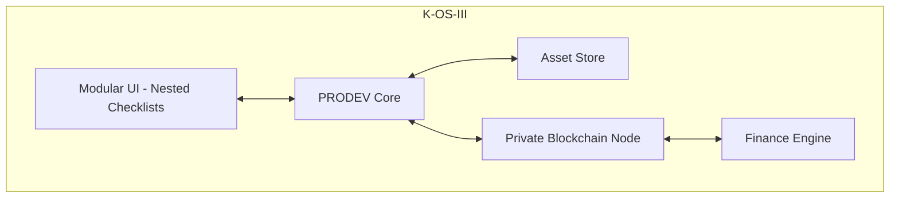

# PRODEV Architecture

> This is the "production credits & residuals" system described in
> [`docs/ACCOUNTS_SPEC.md`](../docs/ACCOUNTS_SPEC.md) § 4 / § 4.2 — that doc
> has the full design discussion (identity integration, the offline signed-
> attestation-log direction vs. a real blockchain, open questions for the
> team). Read it before extending this skeleton.

## System Context
[Users] → PRODEV (K-OS-III) → Private Blockchain

## Container Diagram

Full details in your original prompt.