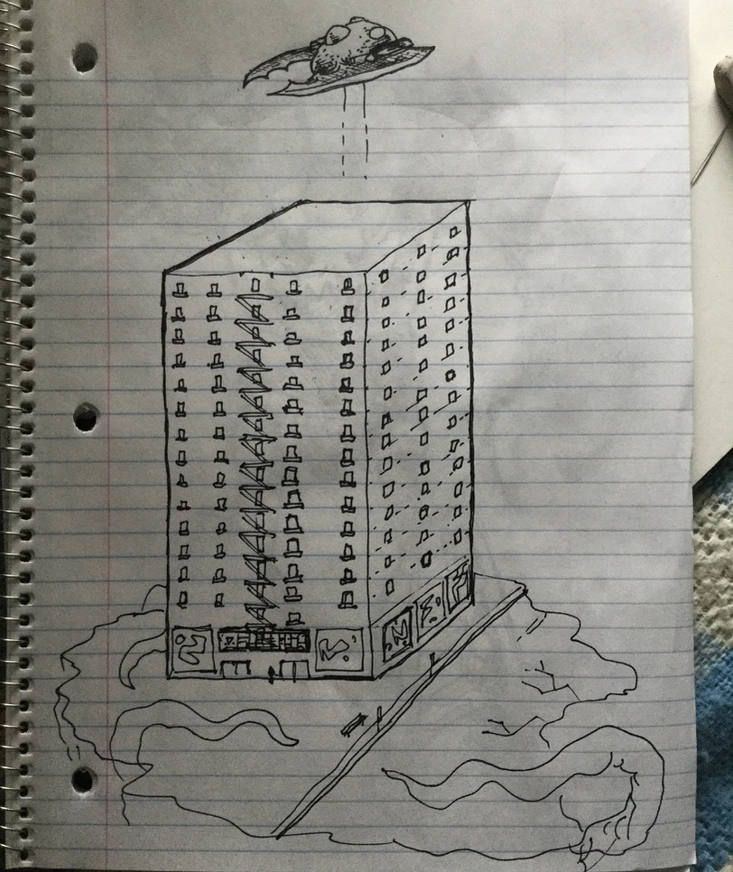
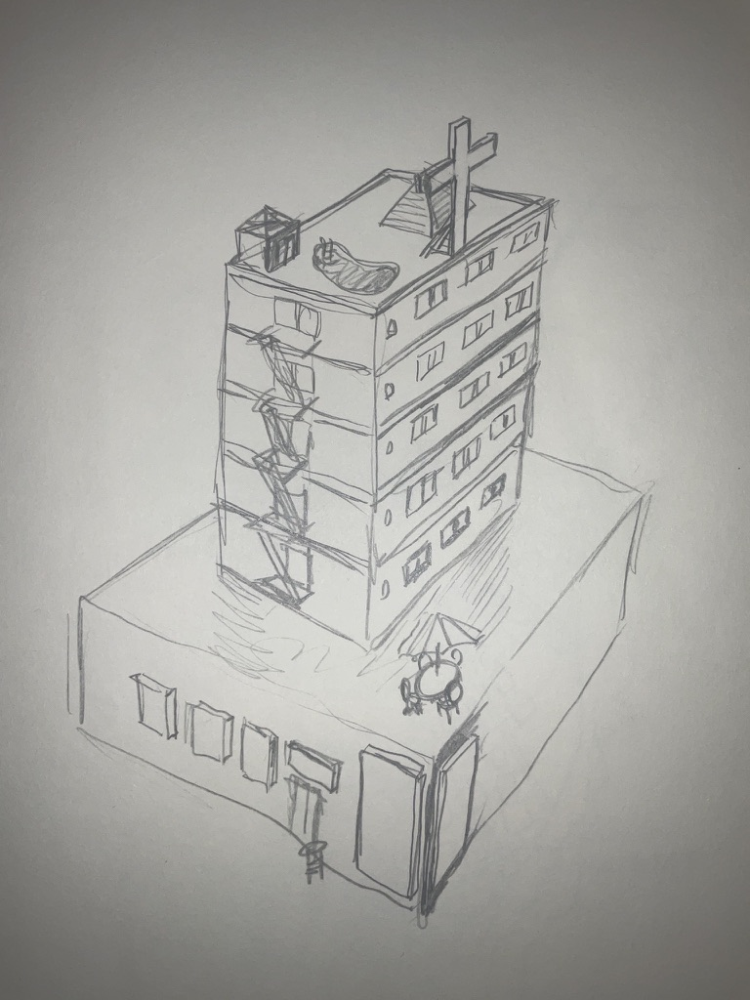
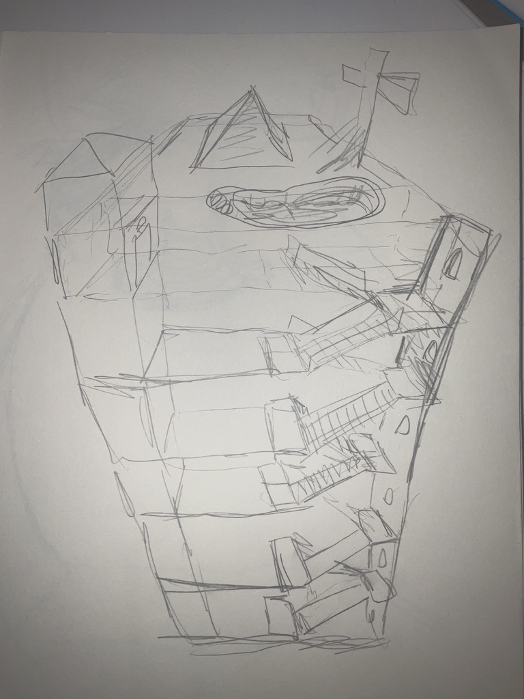
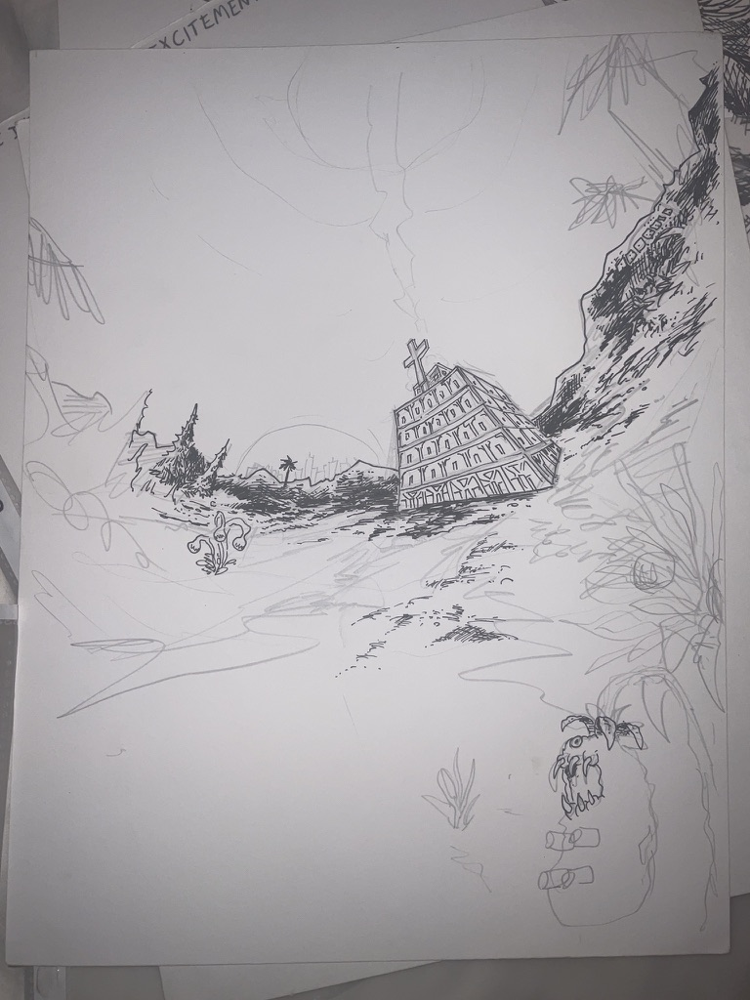
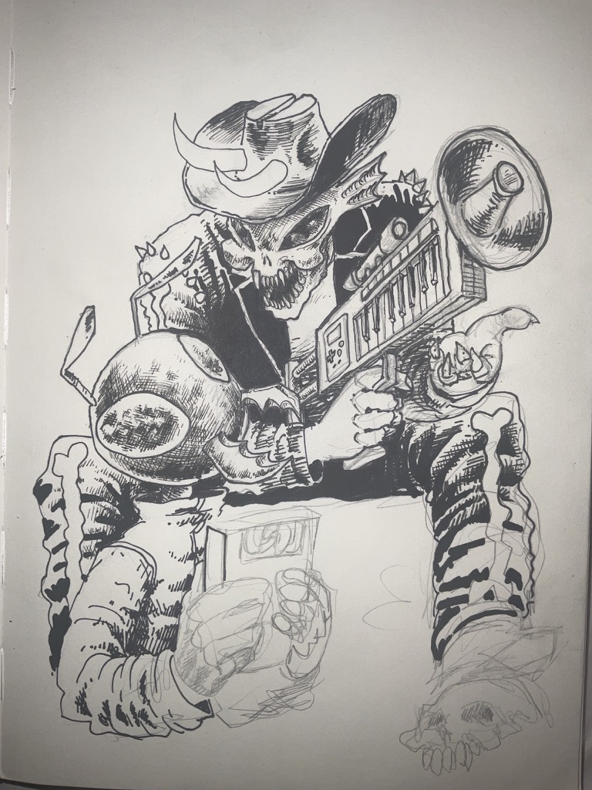
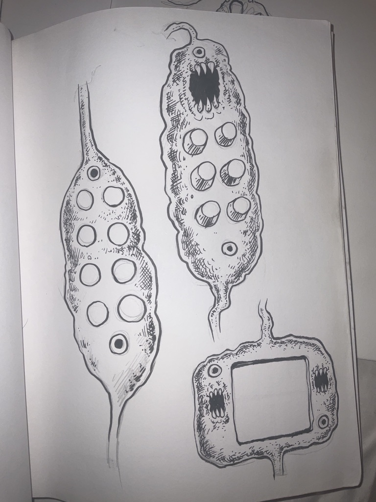
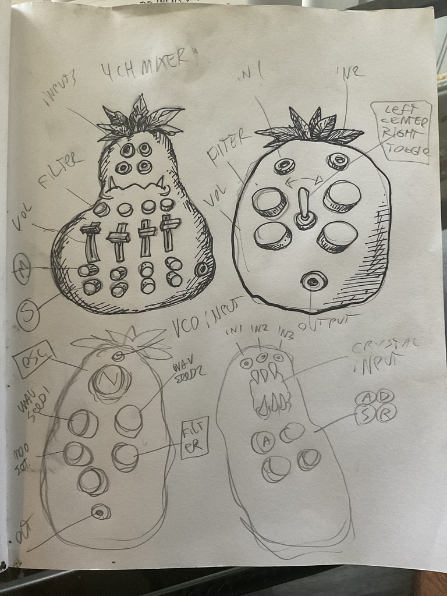
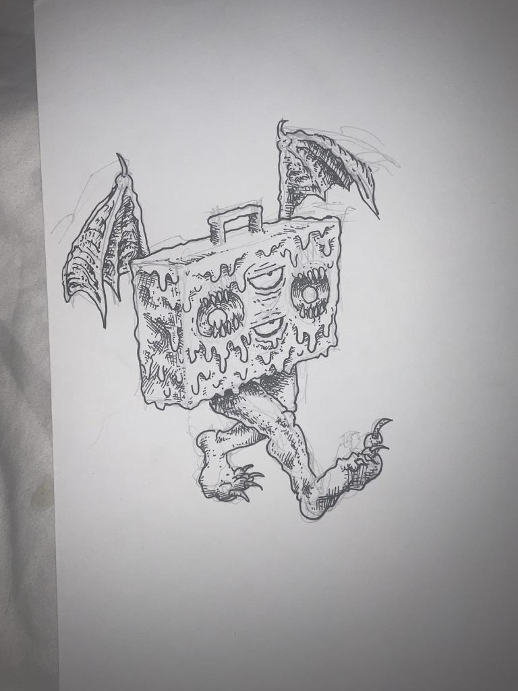
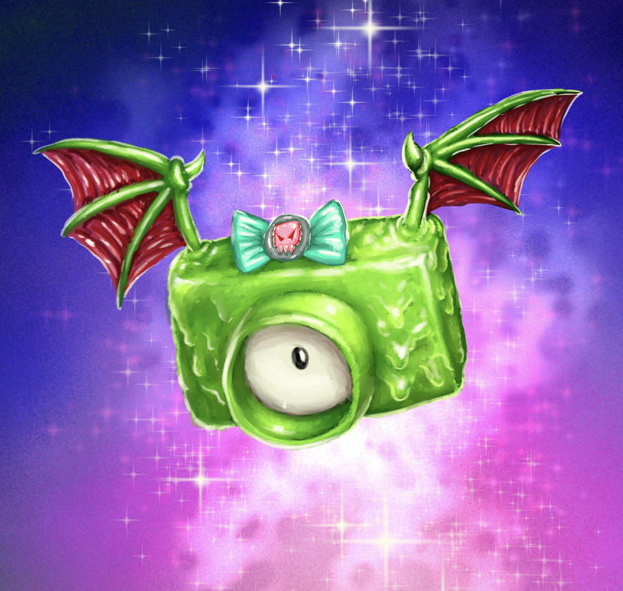
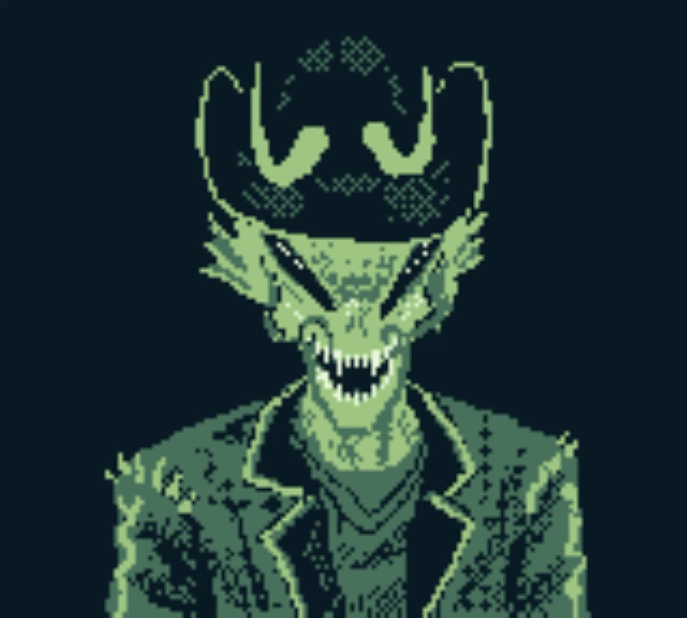

# Stardrain

The front page is the hotel at night, drawn as boxes on a four-color island palette. Hollywood and Mediocricity use the mint-on-navy talk palette. Rooms, levels, menus, games, playlists, and the scene are engine pages, each with its own terminal palette.

Pictures dither to the palette of the page they are on. Click or tap a picture and it opens full screen in its own colors.

## Reference drawings

| Hotel and craft | Hotel tower | Roof | South slope |
|---|---|---|---|
|  |  |  |  |

| Hollywood | Plant bodies | Plant modules | Smile pass |
|---|---|---|---|
|  |  |  |  |

| Winged case | Winged camera | Hollywood, talk colors |
|---|---|---|
|  |  |  |
